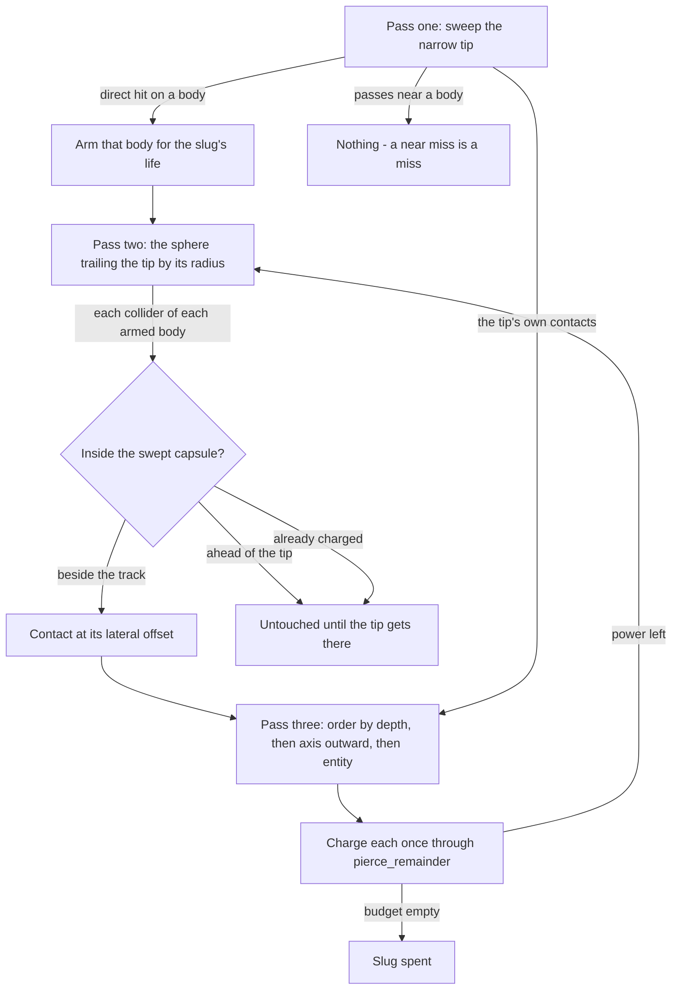
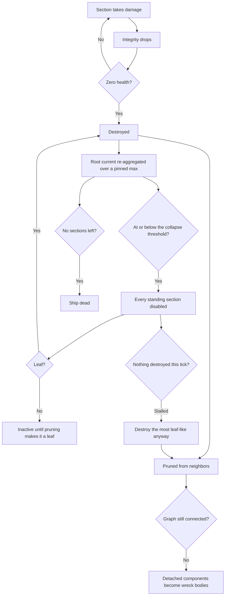

# Spaceship sections and integrity

> To add a new section kind, follow the guide
> [Add a ship section](guide-add-section.md).

Ships are assembled from modular **sections**. Each section is a child entity of
the ship root with its own collider, mass, and health, and contributes one
behavior (structure, thrust, steering, guns). The **integrity** system tracks
how sections connect and handles damage, disabling, and cascading destruction.

## Sections (`nova_ship::sections`)

A section is a `SectionConfig { base: BaseSectionConfig, kind: SectionKind }`.
`BaseSectionConfig` is shared by all kinds: `id`, `name`, `description`,
`health`, a required `build` recipe, optional `destroy_sound`, optional
`collider`, structural `link_points`, `hide_in_editor`, and `damage_effects` -
the authored list of looks this section wears as it is damaged (see [Damage is
two readings](#damage-is-two-readings)).

`build` is a `BuildRecipe` (`nova_gameplay::inventory`): `credits` for the
work, `parts` as a count per `Parts` item id, and `strip_yield` in `(0, 1]`.
It has no serde default, so a section without one fails to load.
`lint_section_recipe` (`nova_scenario/src/lint/ship.rs`) refuses an unknown or
non-Parts item, a zero count, zero credits, a yield outside `(0, 1]`, and a
recipe whose yielded parts at bid are worth as much as the recipe at ask. The
merge lint runs it on every catalog section; the authoring walk and
`check_design_sections` run it on bundle and inline sections. Base rows live
in `crates/nova_authoring/src/base_content/sections/recipes.rs`.

A destroyed section drops `BuildRecipe::strip_parts`, `floor(strip_yield *
count)` of each part, as cargo canisters; a destroyed ship root drops its
hold, and a destroyed station root its `StationStorage` with it. A section destroyed in its root's structural collapse adds its parts to
the root's drop, so a ship destroyed whole leaves one drop. The drop is a
`MinedOreDrop` that the mining ejector drains, so it freezes, thaws and saves
like mined ore (`nova_scenario/src/wreck_cargo.rs`).

### Lost sections and the rebuild

The section spawn of an authored ship inserts `ShipDesignSections`
(`design_sections.rs`) on the root: every design section with its pose and
patched config, live or not. A lost section is a design section with no live
child of that id. Section codes (`PDC-1`) derive from the design by
`ShipDesignSections::class_index`, so a code holds while a sibling is lost and
after a rebuild; a root with no design falls back to the live order.

`remember_lost_section_binding` copies a lost section's live input binding
into the root's `input_mapping` before it despawns, so a rebind the player made
survives the loss and a save.

A thruster with no `SpaceshipThrusterInputBinding` fires on the Main Drive:
`manual_burn_system` (`nova_ship/src/flight/manual.rs`) balances only thrusters
without one. The Ship pane's Control line names the `main_drive` keys from
`InputBindings` (`ShipSectionView::binding_text`). Rebind gives the thruster
its own keyboard key, which fires it alone and takes it off the balance;
reserved flight keys are refused. Backspace while rebinding a thruster
removes the component (`apply_ship_rebind`), and
`on_thruster_input_binding_removed` despawns its action and zeroes its
throttle. The save reads live components (`live_input_mapping`), so a load
keeps an own key, and keeps the Main Drive for a thruster with none.
The pad half stays empty: RightTrigger no longer fires a thruster with its
own key. The autopilot still flies every thruster.

The Ship pane (`nova_interface/src/ship/rebuild.rs`)
lists lost sections while docked to a station that offers `Rebuild`, by
`station_offers` (`nova_gameplay::markers`), the one gate the Inventory pane's
Trade and Storage also read. Its plan
is `plan_section_rebuild` (`nova_gameplay::inventory`): hold parts first, the
rest bought at ask, refused when the station lacks stock, the ship lacks
credits, or `rebuild_anchored` finds no live mate for the lost section's
sockets. A confirmed rebuild moves parts and credits (cause `Rebuild` on both
parties), pushes `ShipInventoryReport::Rebuilt` (`OnRebuilt`), and triggers
`SectionRebuildRequest`; `rebuild_design_section` spawns the section again at
full health through the same per-section spawn the ship was built with.

### Swapping a section

While docked to a station that offers `Refit`, the Ship pane footer's
Catalogue button, left of Fit and Reset, opens the parts gallery
(`nova_ship::gallery`, the editor's picker) over the pane
(`nova_interface/src/ship/catalogue.rs`). A part the selected
live section can be swapped for gets a Swap line in its note and Swap as the
focus card's second verb (`GalleryAlternate`) when `section_swap_family`
accepts the part. The family rule is
the same `SectionKind::class` and the same `SectionFootprint` read from the
authored collider, and another prototype. `plan_section_swap` checks the
gate, the family and the payment;
`plan_recipe_payment` (`nova_gameplay::inventory`) is the one payment rule a
rebuild and a swap share. On a click, `swap_build_fault` runs the generator's
post-build checks on the ship the swap leaves: one socket graph, clear exit
lanes, the thrust floor and the flight computer count (`ShipMeasure`,
`ship_measure.rs`, shared with `nova_world_base::ship_layout`). Only a fault
the swap adds refuses it. A confirmed swap moves parts and credits (cause
`Swap` on both parties), pushes `ShipInventoryReport::Swapped`
(`OnSwapped`), and triggers `SectionSwapRequest`. `swap_design_section`
(`nova_scenario/src/objects/spaceship.rs`) makes the root's design inline,
points the section at the new prototype, moves the root's pinned health by
the two parts' pool difference, and respawns the section at full health with
the binding the old part flew with. The old part is not refunded. A freeze
and a save keep the inline design, so the swap persists.

### Adding a section

The catalogue lists each part that is not `hide_in_editor` and whose recipe
the player's hold and the station's stock together carry
(`plan_recipe_payment` finds no missing part). Credits do not filter: a part
the ship cannot pay for shows the credit refusal. Each `GalleryEntry` carries
a short `tile` line (`180 cr, 2 bought`, or `Needs 400 cr`) that wraps inside
its tile, and the whole price or refusal as the focus card's `note`. Place on
the focus card puts a part in hand (`HeldPart`, shared with the editor).
While a part is in hand, the placement ghost
(`nova_interface/src/ship/ghost.rs`) casts the pointer's ray into the Ship
view, takes the nearest block it enters
(`pick_ship_block`), and snaps to the target of that section nearest the hit
(`nearest_link_point` over `ghost_targets`). A target is a free socket whose
outward lane leaves the ship without entering another block and where
`section_add_clear` finds the part clear, so a section inside the hull or a
socket a part covers is never a target, and a block with none shows no ghost.
`free_link_points` (`section_add.rs`) is every socket no design section mates,
live or lost, so a lost section's socket stays reserved for its rebuild. No
content marks an attachment point; every hull, base, generated or modded, has
them. `section_add_pose` places the part by the player's `MountPose`
(`ShipRuntime::mount`) through `MountPose::snap`: the mating socket is
`MountPose::source` steps on from the part's `natural_link_point` (the socket
facing most nearly opposite) and the roll is `MountPose::roll` quarter turns
(`snap_placement`), using `link_point_pose`. The editor's `snap.rs` solver
and `PlacementPose` use the same `MountPose`, so R (`ship_part_roll`) and F
(`ship_part_socket`) step it alike; in the Ship pane those actions follow the
tilt keys and act only while a part is in hand, and the pose resets when the
part in hand changes. Targets are chosen at the default pose, so a step never
moves the ghost to another point. It refuses an occupied point and a part
with no socket. `section_add_clear` adds the refusal for a collider overlap
with a design section it does not mate (`section_colliders_overlap`), and
`section_add_fit` adds a post-build fault the add makes (`add_build_fault`:
the swap's checks through `refit_build_fault`, with `placement_blocks_an_exit`
for the lanes) and refuses `Obstructed` when the part's collider overlaps a
collider outside the ship. The Ship pane passes the docked station's
(`StationSite::partner_colliders`: the direct child sections of the partner
root and of every other ship docked to it, such as its parked hulls, in
ship-root space, within `PARTNER_REACH_MARGIN` cells of the ship's reach),
and `sync_ship_station_blocks` draws the same boxes as dim outlines in the
Ship view, not selectable. A swap does not check the station. The ghost block
shows at the pose with a Nominal outline for a valid add and a Danger outline
for a refusal, and its callout beside the pointer shows the refusal, or the
price with the parts the hold gives and the parts bought at the station's ask
(`RecipePayment`): the click buys exactly those, so it is the quick buy. A
click with a valid ghost raises
`SectionAddCommand`; a click with a refused ghost puts the refusal on the note
line. A click on a section badge commits the same way (`commit_placement`),
since the badge stops the click. The part stays in hand for the next add. With
no part in hand, a click on a block selects its section. While a part is in
hand, the Ship panel shows the Placing block (`ship/held.rs`) in place of the
selection: the part's icon and name, its price (the aimed placement's
`RecipePayment`, else `plan_recipe_payment` of its recipe), the socket and
roll of `ShipRuntime::mount`, the keys and the note line; Delete is hidden.
Q over empty space or Esc (`close_surface_from_menu_keys`, before it closes
anything) puts the part away. `plan_section_add`
checks the gate, the fit, the binding and the payment (`plan_recipe_payment`,
the full recipe). The new section's binding is `added_section_binds`: the
first live bound section of its class by id lends its binding; with none, a
weapon takes an empty binding for Rebind, a thruster none (it fires on the
Main Drive), and a mining emitter the first of `ADDED_MINING_KEYS` no emitter
holds, refused when all are held. Its id is `added_section_id`: the greatest
id of its class plus `+`, so it sorts last and takes the next code without
moving another. A confirmed add moves parts and credits (cause `Add`), pushes
`ShipInventoryReport::Added` (`OnAdded`), and triggers `SectionAddRequest`;
`add_design_section` (`nova_scenario/src/objects/spaceship.rs`) makes the
design inline with the section appended, writes the binding into the player's
`input_mapping`, grows the root's pinned health by the part's pool, and spawns
the section at full health. `reselect_swapped_section` selects the new section
once it is live, and `ship_input` eases the orbit pivot onto it at the same
radius. `ship_input` consumes a selection only when the section is in the pane
list, because an added section is selected before `ShipSections` lists it.
The Ship side panel scrolls under the wheel while hovered
(`scroll_ship_panel`), and the camera zoom yields to it. The pane footer names
only the keys that apply now (`show_pane_input_hints`).

### Deleting a section

While docked to a station that offers `Refit`, the Ship pane's `ship_delete`
key (Delete) and the panel's Delete button raise `SectionDeleteCommand` for
the selected live section (`nova_interface/src/ship/delete.rs`).
`ResolvedSite::plan_delete` refuses, in order: no dock, a dock with no
Refit, the player's port the dock holds by (`ResolvedSite::port`), a fault
`remove_build_fault` finds (the swap's checks through `refit_build_fault`,
which can only open lanes, plus the last flight computer, refused even on a
ship already short of its count), and a hold too full for the parts. The
parts are the strip rule's: `plan_section_yield` at the section's health
share. `plan_ship_delete` is the one rule the button and the act share. A
confirmed delete puts them in the hold, pushes
`ShipInventoryReport::Stripped` with the player ship's own id as `hull`
(`OnStripped`), clears the selection and triggers `SectionRemoveRequest`.
`remove_design_section` (`nova_scenario/src/objects/spaceship.rs`) makes the
design inline without the section and drops its `input_mapping` entry
(`remember_lost_section_binding` keeps no binding for an id the design no
longer holds), then triggers `SectionStripRequest`, which prunes the section's
mates, lowers the root's pinned health by its pool and despawns it.
`reclad_round_removal` (`shell_skin.rs`) observes the same request and
re-clads only the cells round the hole. No credits move. The per-frame
`update_ship_delete_verdict` caches what a delete of the selection gives
back or why it is refused (`ShipRuntime::delete_verdict`), with or without a
Refit dock. The Delete button shows while there is a verdict. It names the
yield (`Delete: +1 Section panel`, or `Delete: nothing to salvage`) when the
delete can go, and is disabled when it refuses, with the reason in its hover
tooltip (`nova_ui`'s `Tooltip`); the Delete key then does nothing. The note
after a delete names the parts that went to the hold.

### Stripping a docked wreck

Docked with a hull the player may loot (neutralized, or a derelict with
`LootableShipMarker`) that is not a living station, the Inventory pane shows a
strip block over the partner column (`nova_interface/src/inventory/strip/`):
the Strip button that raises `HullStripCommand`, the progress bar, the time,
the sections left and the parts the whole hull is expected to give. The
column header's Take all writes `TakeAllCommand`: `plan_loot_take` plans
what fits of every stack in id order, then the credits, and each moves
through the Take rule. A strip runs the same take first, so it never
demolishes a hull with loot in it. `plan_hull_strip`
(`nova_gameplay/src/inventory.rs`) refuses, in order: not docked, a strip
already running, a living station, a partner the player may not loot, and a
take that would leave a stack or the credits behind (`NoRoom`, read from
`HullStripPartner::loot`). The strip block and `apply_hull_strip_commands`
both read it through `plan_strip_press`: on `NoRoom` the Strip button is
disabled and its tooltip names what has no room, and a press moves nothing.
The plan sums each live section's `StripTarget::parts`
(`BuildRecipe::strip_parts_at`: `floor(count * strip_yield * health share)`
per part) and its `strip_duration_secs`: `STRIP_SECS_PER_PART` (1 s) per
recipe part, at least `STRIP_MIN_SECS` (3 s). A small hold is no refusal:
the strip holds at the first section that does not fit.

A planned strip moves the loot (`take_loot`, the Take all path), then inserts
`HullStripJob` (`nova_ship/src/sections/section_strip.rs`)
on the player root. `advance_hull_strip` (`inventory/strip/mod.rs`) runs it on the
virtual clock with the pane open or shut, so it holds while the TAB
interface is open; the block's progress line and the HUD mode chip
(`STRIP <percent>%`, or `STRIP HELD: HOLD FULL`) show it. It takes one live
section at a time, the one `next_strip_section` names: the farthest from the
berth (the partner's port that holds the dock) in hops over `ConnectedTo`,
sections cut off from the berth first, ties in pane code order, the berth
last, so the rest stays joined to the berth. When a section's timer ends,
`plan_section_yield` plans its parts; a hold without room holds the job
there (`HullStripPauseType::HoldFull`) until there is room. Otherwise the
parts go into the hold, the pane pushes `ShipInventoryReport::Stripped`
(`OnStripped`, once per section) and triggers `SectionStripRequest`.
`strip_section` takes the section off without the destroy path, so it fires
no burst, no `OnDestroyed`, no canister drop and no floating piece: it prunes
the section from its neighbours' `ConnectedTo`, lowers the root's pinned
health maximum by the section's pool, and despawns it. A stripped section is
then a design section with no live entity, as a destroyed one is, so a
freeze, a thaw and a save keep it stripped with no save field. The berth's
parts end the strip: the job triggers `DockingReleaseRequest` for the player
and despawns the wreck, with its hold and credits; a retiring cell freezes
only the bodies still live in it, so the wreck stays gone. An undock, or a
dock with another hull, stops the job and keeps what it took; the job is not
saved.

### Buying a hull

A generated living station sells whole inline designs that `station_hulls`
(`nova_world_base/src/station_hulls.rs`) lays out for its civilization from
the world seed and the station id: one per docking port but one, the count
the station's generated layout carries, so the last port stays free for the
player. Roles cycle from a seeded start through the roles the
civilization's advancement can build, and each hull is `generate_ship` at
that advancement, so the size ceiling tiers the list: a first-ring station
sells small hulls only. They ride `SectorStation.hulls` in the manifest
(checked by `check_ship_design`, refused on a dead station).
`spawn_sector_station` hands every offer to `PendingParkedHulls`, and
`park_pending_hulls` (`nova_scenario/src/objects/parked_hulls.rs`) spawns each
as a real ship once the station's sections are live, in list order: a hull
for sale while two ports are free, docked by `dock_parked_hulls`. A hull takes
the first free port in design order where it stands clear:
`parked_hull_clear_pose` (`nova_ship/src/sections/hull_buy.rs`) poses it by
`parked_hull_pose`, the hull's first port facing the station's, and rolls it
a quarter turn at a time about the port axis until no section overlaps a
station section, a hull parked before it or the three-cell approach lane of
another free port (`section_colliders_overlap`). A hull that fits nowhere is
not parked, with a warning, so a station sells at most its ports less one.
A parked hull is inert: no driver, Neutral, every capability off, not
lootable, no credits. It carries `ParkedHull(station)` and `ParkedHullType`
(`Sale`, `Owned` or `Hire { slot }`,
`nova_ship/src/sections/hull_buy.rs`); the
station's `ParkedHulls` despawns them with it. A parked hull is no persistent
body of its own: `freeze_station` records each in `FrozenStation.parked`
(`FrozenParkedHull`: name, listing, pose relative to the station, ship), and a
thaw parks them again where they froze. A station whose only docks are its
own parked hulls retires; the save format is 11.

The Station pane's "Your ships" and "Ships for sale" lists
(`nova_interface/src/station/shipyard.rs`) show every hull parked at the
docked station as a card (`spawn_hull_card_head` in `station/mod.rs`): a
view of the hull and one line with its name, length and price, then a Buy
button, or the refusal, and an Info button. A ship the player owns
(`Owned`) lists under "Your ships", above the hulls for sale, and says "your
ship" in place of the price, over a Board button. Each list shows only while
it has a card; a button is named by the hull's place among the station's
owned and for-sale hulls (`HullBuy-{i}`, `HullBoard-{i}`, `HullInfo-{i}`).
Info (`station/hull_info.rs`) sets `ShipViewSubject` to the card's hull and
opens the Ship pane: `ShipSections` lists that hull's sections,
`assign_section_codes` codes them, and the view turns, zooms and selects as
for the player ship. Every edit is off while the
subject is set: Catalogue and the part in hand, Delete, Rebind, Repair, the
rebuild list and the station outlines. A header over the Ship panel holds the
card's line and Close, back to the Station pane; leaving the Ship pane any
other way clears the subject too. The view
(`hull_preview.rs`) mirrors the parked hull's own meshes and materials,
posed in the hull's frame, into a scene on the card's render layer, turned
slowly about its vertical axis and lit by a key and rim light on the card
layers only. `mirror_hull_previews` follows the live hull, so damage and a
changed part show; the cameras render, and the mirrors update, only while
the Station pane is on screen.
`plan_hull_buy` checks, in order: docked, `Refit`, and the player's balance
against the price. A hull for sale costs `hull_price_cr`, every section's
recipe at ask, in full: the station pays nothing for the old ship, which
stays the player's. A confirmed buy moves both balances (cause `ShipBuy`),
pushes `ShipInventoryReport::ShipBought` (`OnShipBought`), and triggers
`HullBuyRequest`. Board triggers the same request for an `Owned` hull and
moves no credit and reports no buy. `swap_parked_hull`
(`nova_scenario/src/objects/station_hulls.rs`) keeps the player's ship root,
so the HUD, the camera and the scenario id keep their owner: it freezes both
hulls, rebuilds the root as the parked hull (`rehull_ship`) at its pose with
the start-role bindings for the new hull (`start_role_bindings`: turrets the
trigger, railguns R, torpedoes F, the first emitter V and each later one the
next `ADDED_MINING_KEYS` key; no old binding carries over), and parks the old
ship where it stood as `Owned` with `OwnedShipMarker`.
The old ship keeps its hold; the Inventory pane lists the hold of a docked
`OwnedShipMarker` ship as storage. `OwnedShipMarker` (`nova_gameplay`) is
the one record that a ship is the player's: an `Owned` parked hull carries
it, and `PlayerFleetMarker` requires it, so an escort does too; a neutralized escort
loses both. The root takes the bought hull's name. The old port's despawn
releases the dock, and `redock_bought_hull` docks the new hull with the
station, giving up with a warning after `REDOCK_FRAMES`. A docked ship
that is not the station's own parked hull keeps the station from retiring,
so the player undocks the bought hull normally.

After its hulls for sale the station lists one to three escorts for hire
(`HullOfferType::Hire { slot }`), each parked as `ParkedHullType::Hire` but
not docked: it coasts beside the station, inert like a hull for sale. The
escorts stand on a line through the station, alternately ahead and behind,
`hire_offer_offsets` (`nova_ship/src/sections/hull_buy.rs`) spacing each past
the station's reach and the one before it plus `HIRE_OFFER_CLEARANCE`
(100 m); a reach is the farthest section's centre plus its collider's
half-diagonal (`design_reach`). In a gravity well that holds the station,
`hire_offer_place` rotates the station's pose and velocity about the orbit
pole by the offset over the orbit radius, so an escort shares the station's
orbit a little ahead or behind and does not drift; in flat space it stands
along the station's +X with the station's velocity and spin. A thaw places
the escorts again by the same rule. Fighting roles (scavenger, armored) the
civilization can build, cycled from a seeded start, none where it builds no
fighting role. Each keeps its roster slot, so `escort_id` (station id, stem
`<stem>_<index>_escort`, the slot as index) gives one escort one id however
the earlier ones were hired. The Station pane's "Escorts for hire" list
(`nova_interface/src/station/escorts.rs`) shows each escort coasting beside
the docked station on the same card as a hull for sale, with a Hire button
or the refusal. `plan_escort_hire`
(`nova_ship/src/sections/escort_hire.rs`) checks, in order: docked, `Refit`,
a free fleet slot (`FLEET_SIDES`, starboard then port, so the cap is two),
the player's balance against the price, and the station's balance plus the
price. The price is `escort_price_cr`, `hull_price_cr` times
`ESCORT_HIRE_FACTOR` (3/2). A confirmed hire moves both balances (cause
`EscortHire`), pushes `ShipInventoryReport::EscortHired` (`OnEscortHired`)
and triggers `EscortHireRequest`. `hire_station_escort`
(`nova_scenario/src/objects/fleet.rs`) freezes the offer, despawns it and
thaws the record as the escort under `escort_id`, where the offer coasted
and at its velocity: an AI driver leashed at `ESCORT_LEASH`, Player-sided,
every capability on, with an empty hold and no credits, then adds
`PlayerFleetMarker` and `AIFollow`.
`update_follow_flight` (`nova_ship/src/input/ai/follow.rs`) flies the escort
as the combat pilot flies: a held `MatchVelocity` of the leader's heading at
a lagged speed plus a closing speed the hull can brake from (`ai_radial_speed`,
at most `AI_FOLLOW_CLOSING_SPEED`, 2 u/s). Only a speed gain lags
(`AI_FOLLOW_FEED_LAG`, 2 s); a turn or a slow-down is flown at once. It never
holds a velocity against the leader's travel. The held velocity refuses the
RCS (`MatchVelocity { rcs: false }`), so the escort turns onto the error and
burns its drive: an RCS push turns no hull and lights no drive plume, and an
escort that took up the leader's start on it slid along as if dragged. The RCS
is allowed for two things. It dodges: inside the leader's clearance (both
arms plus 10 u), or when the leader closes on the escort fast enough to reach
that clearance within `AI_FOLLOW_DODGE_LEAD` (2 s), about the time the drive
takes to turn. And it trims: within `AI_FOLLOW_TRIM` (6 u) of the goal, with
the error and the speed lag inside the flight computer's crumb band
(`attitude_deadband`), once the leader has held its velocity for 1 s. A leader
that starts, stops or turns leaves the escort to its drive. So a leader that starts from rest opens a gap before its escort follows, and
only the escort's drive and computers move it. The goal is
`formation_goal`. A leader at or above `AI_FOLLOW_TRAVEL_SPEED` (1 u/s) sets
the frame with its travel, not its nose: the slot is the side times both arms
plus `AI_FOLLOW_GAP` (20 u), `AI_FOLLOW_TRAIL` (10 u) behind the leader. A
slower leader leaves the escort where it is, pulled into `AI_FOLLOW_HOLD`
(15 to 40 u between the hulls), so a hull turning in place keeps its escort
still. The leg is planned in the leader's frame with `plan_leg`, round the
leader, every other hull and every sized body by the escort's arm plus 10 u.
`plan_leg` cannot steer out of a clearance it starts inside, so an escort
inside the leader's clearance first flies straight out of it.
Far from its goal the escort points at it; within 20 u it points where the
leader points. It keeps its leash centred on the leader and gives way to a
combat engage. A leader that locks its escort within the far hold gap is
coming to dock: the escort coasts on its own velocity, with no dodge, no
clearance and no RCS, and the dock admits it as any calm ally. Docked, it
replaces its maneuver with a STOP and holds the pair, as a docked passive
driver does. At the undock it flies formation again, though the leader still
locks it, until the leader locks something else. A neutralized escort leaves
the fleet.

Docked at a living generated station (it wears a `GeneratedBodyId` and is not
derelict), the Station pane's "This station" block
(`nova_interface/src/station/station_buy.rs`) offers the station itself. No
authored service gates it: every such station is
for sale. The price is `station_price_cr`
(`nova_ship/src/sections/station_buy.rs`): every live section's recipe at ask
(`hull_price_cr`), the station's hold at ask and its credits, times
`STATION_OWNERSHIP_FACTOR` (2/1). The player's storage there is already the
player's and is not priced. `plan_station_buy` checks, in order: docked, for
sale (`StationSaleType`), not owned, and the player's balance. A confirmed buy
charges the player (cause `StationBuy`), pushes
`ShipInventoryReport::StationBought` (`OnStationBought`) and inserts
`owned_station()` on the station root: `OwnedStationMarker`,
`Allegiance::Player` and `OWNED_STATION_NAME` ("Owned station"). The
station leaves its civilization: its AI targets the player's foes, the
relation model, the HUD and the Map read it as the player's side, and its
name no longer carries the civilization's. The price goes to the
civilization, so the station keeps its balance, stock and services. An owned
station admits the player whatever the player's side (see "Who lets a dock
in"), and sells its hold to the player at bid (`TradePriceType::Owned` in
`plan_item_trade`); storage
withdraw was already free. Its services still price at ask, its credits are
its trading float (Take does not reach them), and it earns nothing yet: the
`TODO(20261012-100028)` in `thaw_station` is where income will accrue.
Ownership has one source of truth: the live marker, and `FrozenStation.owned`
in the frozen record a retire or a save writes and a thaw reads back. The side
and the name freeze with the hull (`FrozenShip`) and the body (`FrozenBody`)
as every ship's do; the side alone cannot mark ownership, since a generated
civilization can be on the Player side. The chart keeps `ChartStation.owned`
from the dock and the undock, and the Map's chart view names the station
`OWNED STATION` in the ally colour. The generator still describes the station
as its civilization's, a pure function of the seed; the frozen record
replaces that description once the cell retires or saves, and nothing at
runtime counts a civilization's stations.

`SectionKind` variants (one module per kind under `crates/nova_ship/src/sections/`;
`turret_section/` and `torpedo_section/` are directories, not single files):

| Kind         | What it does |
|--------------|--------------|
| `Hull`       | Passive structure/armor. Just a `render_mesh`. |
| `Thruster`   | Forward thrust (`magnitude`); drives the exhaust visual. |
| `Controller` | Attitude controller (`steering_lag`, `max_torque`); lag derives the internal PD gains, torque feeds the hull's attitude envelope (see below). Attitude hardware only - what a ship is PERMITTED to do is `ShipCapabilities` on its root. A ship needs one to be steerable; several SHARE one attitude loop. |
| `Turret`     | Aims and fires bullets. An authored joint tree (hinges + muzzles, each joint with its own `offset`/`axis`/`speed`/limits/`render_mesh`), section-wide `muzzle_speed` + authored `bullet_damage` + `bullet_kind`, per-muzzle `fire_rate`, optional `ammunition: Limited(n)` drawing `PdcRound` on reload. |
| `Torpedo`    | Torpedo bay. Fires guided torpedoes of an authored `torpedo_type` (name, tint, `max_speed`, `weave_angle`, `weave_rate`) that detonate an Explosive area blast (`blast_radius`, `blast_damage`), optional `ammunition: Limited(n)` drawing `Torpedo` on reload. The TYPE is the run-in - how fast and how evasively; everything else on the config is the tube. |
| `Railgun`    | Spinal lance. No traverse: the HULL aims it down `muzzle_offset`. Tapping the trigger commits, the bolt walks the bore for `charge_seconds`, and the shot leaves whether or not the nose is still on the target. The slug deals `slug_damage` to every layer it rakes; `slug_power` and not a layer count bounds it, optional `rake_radius` spends that budget on a wider corridor instead of unused depth, `slug_speed` x `slug_lifetime` is the reach, and `recoil_impulse` lands at the muzzle point so an off-axis mount yaws the ship. Usually `ammunition: Limited(1)` with a long `reload` drawing `RailSlug`. |
| `Docking`    | Docking port. A cylindrical, rotationally symmetric collar that holds this hull to another one. `capture_distance`, `capture_angle` and the two relative-speed ceilings are the envelope a `DOCK` is graded against; the sleeve that reaches across once the dock holds is an animation track, not a collider (see [below](#docking-ports-and-what-holds-a-pair-together)). |
| `CargoIntake` | Cargo intake. Takes a `CargoCanister` whole into the ship's `ShipInventory` and drops the Inventory pane's jettisons from a `CargoIntakeEjectionQueue`, front first, one at a time while the door is open and the birth point is clear. Each live intake owns a detached static Avian `Sensor` trigger, `aperture_width` by `aperture_height` by `capture_gap` deep, in front of the `Cuboid` collider's -Z face: not a child collider, since the workspace has no collision layers and a sensor in the ship's compound would join it for mass, bullets, locks and overlap reads. `detection_range` opens the door for a canister that fits the hold's free mass (visual only for a take); a canister whose collider touches the trigger is taken whole, at any speed, if the hold has room; a canister in two triggers goes to one intake once; `eject_speed` sets a drop; the `IntakeDoor` track gates only the drop. The door, drop and take trigger events that `ship_audio/machinery.rs` voices (`cargo_intake_section.rs`). |
| `Mining` | Mining emitter. Each emitter deploys on its own key: a player ship's `input_mapping` entry for the section becomes a `SpaceshipMiningInputBinding` rig that sets that section's `MiningSectionHeld` (`input/player/weapons.rs`), and lint and spawn refuse a player mining section with no entry or an empty one, and two mining sections that share a source. While it is held, `drive_mining_emitters` opens the `StowDoors` track, then extends the `StowLift` tip; on release the tip goes in before the doors shut (`mining_section.rs`). Each change of the doors' target triggers `MiningDoorsMoved`, and `ship_audio` plays the authored `door_open_sound` or `door_close_sound` at the section; the spawn snap and a held key play nothing. Each fully deployed emitter pulses on its own clock every `pulse_interval_seconds`. A pulse casts a ray from its collider's -Z face against the travel-locked rock alone, within `reach`, and carves `carve_radius_cells` at the hit. Ore is paid per newly emptied corner after the remesh, then leaves the rock as canisters one at a time. A passed pulse plays the authored `pulse_sound` at the hit and, in a rendered app, flares the additive beam shader (`assets/shaders/mining_beam.wgsl`) and throws a fixed spark burst. A refusal is a `MiningPulse` with a `MiningRefusalType`, plays the authored `refusal_sound` once at the emitter face and changes nothing (`nova_scenario/src/mining.rs`). |

`run_cargo_intakes` publishes `CargoPickupReadiness` for each live intake/canister pair on the fixed clock, including out-of-range canisters. A pair names only the ship, intake, canister and `ready`; it carries no pose. The HUD draws its live pickup sight for one published pair from rendered `GlobalTransform` poses, with the face from `cargo_intake_face`, the helper the fixed pass also uses. The canister must be within `CARGO_PICKUP_SIGHT_RANGE` (200 m) of the player's ship, with no lock needed: a travel-locked canister first, else the nearest intake face, then the lower entity IDs (`pickup_sight.rs`). No pair in range draws no sight. A take despawns the canister in the same pass, so the sight clears with it and `CargoCanisterTaken` voices the take.

`GameSections(Vec<SectionConfig>)` is the resource of section blueprints.
Every base prototype is GENERIC and authored under
`crates/nova_authoring/src/base_content/sections/`, one module per family
(`hull`, `controller`, `thruster`, `turret`, `torpedo_bay`, `railgun`,
`docking_port`, `cargo_intake`, `mining_beam`); a mod that brings modelled craft declares their parts itself. The explicit `section_catalog()` is
generated into `assets/base/sections/base.content.ron` by `content -- gen` and
merged into the resource by
`crates/nova_assets/src/merge.rs`. The outer-skin cladding is not a prototype at
all: a ship's skin is DERIVED from the structure it wraps by `nova_ship`'s
`shell_skin` ([below](#the-derived-skin)), so no id names a plate. Look a
section up with
`sections.get_section("basic_thruster_section")`.

### The attitude envelope, and how controllers stack into it

How hard a hull may turn is DERIVED, not authored. `AttitudeEnvelope`
(`crates/nova_ship/src/physics/attitude.rs`) is two ceilings and the lower of
them:

```
alpha_max = min( sum(max_torque) / I ,  LOAD_LIMIT / (r * METERS_PER_UNIT) )
                 \___ propulsive ___/   \________ structural ________/
```

- `I` is the hull's largest principal moment of angular inertia, read off
  avian's `ComputedAngularInertia`. No formula for it lives in Nova: it is the
  second moment of where the mass actually sits, so no curve in any single
  length can stand in for it.
- `r` is the structural arm, from the hull's centre of mass to the outer FACE
  of its furthest live section. `structural_arm` measures it off posed
  colliders, so its answer is in engine world units and the caller crosses it
  with `Meters::from_engine` before `AttitudeEnvelope` divides by it - which is
  why `METERS_PER_UNIT` appears in the formula above and not in the code. The
  Ledger corvette reads 2.76 u, i.e. 27.6 m. `BodyRadius` is a
  scenario-obstacle radius and is not it.
- `LOAD_LIMIT` is `crates/nova_events/src/scale.rs` and `METERS_PER_UNIT` is
  `crates/nova_events/src/units.rs` - one definition each, shared by the
  physics and by the player-facing formatter in `nova_ui::units`. Both halves
  of the world's scale, and the
  [boundary they sit on](architecture.md#units-and-scale).
- The ceiling comes out in rad/s^2 either way: `LOAD_LIMIT / r` is
  (m/s^2) / m, so the scale cancels and no figure on this page moves with it.

The two structural loads are perpendicular components of one acceleration at
the tip, so they add as a VECTOR: `alpha^2 + omega^4 <= (LOAD_LIMIT / r_m)^2`.
A hull already in a hard turn has spent its margin, and its sustained rate is
`sqrt(LOAD_LIMIT / r_m)`. Past that corner the centripetal load alone is over
the limit and the full ceiling comes back, so an over-spun hull can always shed
rate.

That returned ceiling is a MAGNITUDE, and the loop that spends it is what
keeps it pointed the right way. `AttitudeEnvelope::available` is paired with
`sustained_turn_rate` on the same `PDController`
(`sustained_angular_speed`): past that rate the PD drops whatever part of its
requested acceleration lies along the spin and keeps the rest, so the
authority can brake and steer but not tighten. Without the pairing a held turn
spends the returned ceiling on going faster and settles wherever the
controller gains run to - which is what the load limit exists to stop, and
what `examples/systems/system_turn_limit.rs` flies.

Two consequences to expect rather than debug. A small hull is STRUCTURE-bound,
so fitting more computers to it changes nothing at all. A hull that loses
sections shortens its arm and turns SHARPER than it did intact.

Every live controller torques the hull in parallel, so a hull with several of
them would multiply both its gains and the applied torque by the section count.
`update_controller_stack_tuning`
(`crates/nova_ship/src/sections/controller_section.rs`) prevents that: it runs
first in `FixedUpdate` (`ControllerSectionSystems::SyncStack`), derives ONE
ship-level attitude loop per root, and writes each live controller a share of
it into its `PDController`. The authored numbers stay put in
`ControllerSectionTuning`, which is what the pass re-derives from when a
controller dies. The smallest live `steering_lag` supplies the stack's base
response.

The pass measures or it does nothing. A root with no finite, positive inertia
and arm yet - the spawn frame before avian has computed mass properties, or a
hull that has lost every live section and is no longer sized at all (see
`publish_hull_radii`) - is SKIPPED, and every controller on it keeps the tuning
it already had. Dividing by a missing arm writes an infinite structural ceiling
onto each `PDController`, which disables the load clamp for that tick.

The ship-level loop, for `n` live controllers:

- authority: the envelope above. Torque SUMS across controllers, with no curve
  and no cap of its own, because the structural ceiling already caps the
  result. Each controller's share is its own fraction of the hull's torque.
- P gain: DIVIDED by `stack_curve(n, 1.5) = 1.5 - 0.5 / n`, which increases the
  effective steering lag so the stack brakes earlier and lands on the commanded
  attitude instead of sailing past it.
- D gain: held at exactly one fastest computer's worth. This is not tuning: `kd * dt`
  crosses 2 at two controllers on the shipped tuning, and past that the PD
  limit-cycles instead of parking (the corkscrew that used to follow a
  released maneuver).

`ship_turn_rate` (`flight/guidance.rs`) then sums the live acceleration shares,
which is why the flight layer is ordered after `SyncStack`. `n = 1` is the
identity case.

The precision division is the one part of the stack that a structure-bound hull
does not pay for: it has no extra authority to spend, so a stack costs it a few
per cent of peak rate and a tick or two of onset in exchange for landing
cleaner. Measured in `flight/tests/stacking.rs`, which prints the table.

### The spinal lance

`Railgun` is the one weapon kind whose aim is the HULL. It fires down the
section's own `-Z`, has no joints and no cone, and that is why it is its own
`SectionKind` arm rather than a turret with a narrow arc: the turret code is
about cones and joints, and a lance has neither.

The whole cycle is one system, `charge_and_fire_railgun`
(`sections/railgun_section/firing.rs`), on the FIXED clock:

- **The commit.** A trigger pull moves `RailgunCharge::Ready` to `Charging`.
  The MAGAZINE gates the commit rather than the shot - committing an empty gun
  would burn a charge for nothing and hide the reload from the player - and the
  shell is spent only once the shot is certain. The section reads
  `RailgunSectionInput` and never clears it, so a held trigger is a gun cycling
  at its own cadence rather than a second mechanic.
- **The safety is LIVE through the charge.** `WeaponsHot` gates the commit and
  is re-read every tick: a gun safed mid-charge dumps the charge, snaps the
  `Charge` cue back to 0 and KEEPS its shell rather than firing it into a
  friendly. That is the only way out of a commit; the trigger has none. A ship
  carrying no `WeaponsHot` (a bare headless rig) fires freely.
- **The charge.** `charge_seconds` runs off `Time`, and the `Charge` animation
  cue is SNAPPED to the gameplay fraction every tick rather than played. Both
  travel times on the shipped `charge_bolt` track are zero for that reason: an
  authored travel time would be a second clock, and the bolt would reach the
  brake before or after the shot it announces.
- **The shot and its recoil, in the same tick.** They have to share one, or an
  impulse applied a tick late pushes a ship that has already moved on from the
  pose it fired in. That is what keeps the cycle in a single system and earns
  its `too_many_arguments` expect. The bore is read off the RAW physics pose
  through `local_pose_in_root`, not `GlobalTransform`, which inside FixedUpdate
  still holds the previous frame's eased render pose. The slug inherits the
  muzzle's full rigid-body velocity, swing included.

The slug is an ordinary `nova_gameplay::rounds` Pierce round with
`layers: u32::MAX`, so `slug_power` alone bounds the depth: it curves in wells,
is charged once per layer through `pierce_remainder`, and needs no second damage
pipeline. `slug_damage` is dealt FLAT to every layer (`hit_bite` does not scale
Pierce), while each crossing costs that layer's MAX health divided by
`pierce_power_multiplier` - and a slug at 15,000 m/s always sits at that curve's 3.0
ceiling, so the shipped 1800 power is 27 reinforced hull blocks.

Nothing that flies is 27 blocks deep, so the optional `rake_radius` spends the
surplus on WIDTH: a sphere of that radius trails the tip, tangent to it, and
everything it sweeps over a body the tip DIRECTLY hit takes the same flat bite
out of the same budget. `RoundRake` carries the arming, per body and for the
slug's life; `sweep_raking` resolves the tip, the trailing capsule and the
charge order in three passes. Omitted, no `RoundRake` is inserted at all and
the slug takes the untouched narrow path. The base lance authors 10 m,
measured against 40 m in `system_railgun_lance`'s stand bank: both spend the
same budget, and the radius chooses whether it goes through the hull or across
its face.

One fixed step of a raked slug, as `sweep_raking` resolves it:



The capsule test is analytic - the corridor measurement from `corridor_contact`
against the sphere's track - rather than a spatial query, because parry's
`intersection_test` returns false negatives for shallow overlaps against a
capsule this long - a slug at 15,000 m/s sweeps 23 world units of the
capsule parry is being asked about per 64 Hz step, which is 234 m - and the
first
version of the rake, which queried, cut a corridor with its corners missing.
The body's own colliders are the candidate set, so there is no query cap under
the power budget either.

Recoil goes through `apply_linear_impulse_at_point` AT `muzzle_offset`, never at
the centre of mass, so an off-axis lance yaws the hull every time it fires.
`every_lance_puts_its_muzzle_on_the_brake_face` pins the offset to the face for
exactly that reason: it is one number that is silently wrong in two ways at
once - the slug spawns inside the gun, and the torque is off by the same
distance. `every_lance_holds_exactly_one_shell` pins the other half of the
design: capacity 1, a reload of 1, and a reload delay longer than the charge, so
the reload is the tempo.

The lance's sockets (`lance_link_points`, `nova_authoring`) leave the muzzle
face bare. A lance cannot traverse off its own line, so a socket there is an
invitation to bolt a plate into the bore;
`no_lance_sockets_the_face_it_fires_through` holds it.

The pilot-facing half is `nova_hud`'s bore sight
(`crates/nova_hud/src/bore_sight.rs`), the only instrument that says where a
hull points. It traces the bore and walks the crossed sections through the SAME
`pierce_remainder`, ringing each section the shot would destroy - a sight with
its own copy of the pierce math is a sight that eventually lies. It is gated on
`WeaponsHot` and drawn dimmed rather than hidden on an empty magazine.

The AI half is deliberately crude and recorded as such
(`crates/nova_ship/src/input/ai/railgun.rs`): a raider commits when its orbit
happens to sweep the bore across a target it is already fighting, inside about
eight degrees and 60% of the slug's reach, with a per-gun cadence over the gun's
own reload. It does not FLY the shot.

### Docking ports, and what holds a pair together

A dock is deliberately NOT an attachment. Two docked hulls stay two rigid
bodies held by one avian `FixedJoint`, and every part of the mechanic follows
from that: no authority moves, no mass is merged, and either ship can leave.

The code is `crates/nova_ship/src/sections/docking_section/`: `mod.rs` is the
config and the sleeve's state machine, `port.rs` the candidate search, and
`connection.rs` the connection's whole life.

**Finding a pair** (`DockingPorts`, a `SystemParam`). `DOCK` names two SHIPS -
the presser and the ship it has locked - and the game picks the ports. A port
is eligible when it carries no `DockedPort` and is not `SectionInactiveMarker`.
Each pair is then graded on the STRICTEST of the two ports' envelopes, so a
hull cannot loosen another's rules by offering a lax port:

- the **face gap** between the two RETRACTED outer faces, not between section
  origins. A port's face is `(0, 0, -0.5)` in its own frame, because a section's
  outward axis is local `-Z` everywhere in Nova.
- the **opposition** of the two outward axes, within `capture_angle`. Roll about
  the docking axis is not read at all: the ports are cylinders, so a twist is
  not a misalignment.
- the **relative** linear and angular speed of the two BODIES. Absolute speed is
  irrelevant; two hulls holding formation at 2 km/s are stationary to each
  other.

`best_candidate` ranks survivors by `(gap, opposition, first_id, second_id)`.
The two `EntityId`s are the tie-break, so two identical pairs resolve the same
way on every machine and in every replay.

**Making the joint.** `DockingConnectionRequest` re-runs the search - the
envelope is re-read at execution, never trusted from the frame the offer was
drawn in - and spawns ONE connection entity carrying both the
`DockingConnection` record and the `FixedJoint`. The joint is built with
explicit LOCAL frames, taken from the two body poses `(p1, r1)`, `(p2, r2)`
and the midpoint `m` of the two faces:

```rust
FixedJoint::new(first_ship, second_ship)
    .with_local_anchor1(r1.inverse() * (m - p1))
    .with_local_anchor2(r2.inverse() * (m - p2))
    .with_local_basis2(r2.inverse() * r1),
JointCollisionDisabled,
```

Both anchors land on `m`, and the second body's basis holds the relative
rotation the two hulls met at, roll included. Do not use the global
`with_anchor` / `with_basis`: avian3d 0.7 converts a global basis as
`basis * rot.inverse()` where its solver needs `rot.inverse() * basis`, so the
joint holds the capture pose only when the two hull rotations commute. A
belly-up hull against a yawed partner does not, and the joint swings the
partner into the hull. A bare `FixedJoint::new(a, b)` carries
`JointFrame::IDENTITY` and would yank the two hulls into the same origin.
`JointCollisionDisabled` stops the two docked hulls from colliding with each
other: a skin plate or a greeble that reaches past a port face pressed on the
other hull every step, and the contact damage wore both down while they sat
still. Two hulls docked at one station are not joined to each other and
still collide.

Nothing writes a velocity anywhere on this path. The constraint is the physics'
job, so a pair that met while drifting keeps drifting; a hull that had been
zeroed on capture would be a hull the solver has to fight.

**The sleeves.** `DockingSectionState` runs `Retracted -> Extending ->
Extended` off the `DockTube` animation cue, and back down on release. It is
driven only AFTER the joint exists, so the tubes can never be what holds the
ships together. The track is a plain `Translate` on `dock_tube*` nodes: art
only, with no collider growth, which is why two mated sleeves may overlap
without the hulls touching.

**Who lets a dock in.** `DockAdmission::refusal` is the one admission point,
read by the DOCK chip and by the request. A ship target refuses with
`DockRefusalType::Combat` while Hostile, Enemy, answering fire or fighting
(a neutralized target admits). A station target (`StationMarker`) answers by
`station_admission(allegiance, derelict, occupied, owned, hostile)`, in that
order: `StationOccupied` while every live port on its root is held (a held
port is no candidate in the port search; this names the reason so the HUD
can say it); admitted for a station the player owns
(`OwnedStationMarker`) or a derelict, on any side; `EnemyStation` for a
living station on the Enemy side; `HostileStation` for a living station the
ship is hostile to by `ship_relation` (a Player station and an Enemy-flagged
ship, or a station answering the ship's fire); and admitted otherwise. `FlightVerbHints::dock_refusal` carries a station's line (`<NAME>
REFUSES DOCKING`, `<NAME> DOCK OCCUPIED`) while the travel lock is on it; the
mode chip shows it and the DOCK chip reads `DOCK REFUSED`. A ship's refusal
stays the dark chip.

**A station is a hub.** A ship holds one connection (`DockedShip`); the port
search names no pair for a ship that already has one. A station holds one
connection per port: each connection to it carries the relationship
`StationDock(station)`, the station lists them in `StationDocks` (Bevy
removes it with the last one) and carries `DockedStation { helm, drives }`,
the station side of `DockedShip`, while it holds any. The station and every
hull docked at it are ONE assembly. A dock between two stations is refused.

**One hull drives the assembly.** `DockingConnection.helm` is `DockedHelmType`:
`Neutral` (a ship dock's start, and the state after a lost holder),
`Held(player)`, toggled by `DockingHelmRequest` from the `dock_helm` binding
(H), or `Station(station)`, set at capture when the partner is a living
station and never toggled: `helm_on_capture` gives a living station its own
helm, a dead station `Held(player)`, and two ships `Neutral`. A request to
take the helm of a pair with `measurement_fault` is refused, and
`helm_request_admitted` refuses every request on a station-held pair;
handing a held helm back is not refused. For a ship pair the driver is the
holder while `Held`, else the non-player endpoint, else `second_ship`. For a
station hub it is the player holding the helm of its own connection (only at
a dead station), else the station. A station drives with torque alone (its
bridge's attitude loop as the helm wrench) and no thrust, so a station-held
assembly stays where it is. `measure_docked_assemblies`
(`DockingSystems::Assembly`) writes `drives` on every root (`DockedShip` or
`DockedStation`) and a `DockedAssembly` (combined mass, world centre of mass,
velocity, root-frame inertia, reach) measured every tick over N roots, with
the parallel-axis term written out. An unmeasurable assembly logs an error
once, drives no root and sets `DockingConnection.measurement_fault` on every
connection of it; the next measured pass clears it, and a new connection
starts clear.

`DockedShip.drives` is the single gate, read at the FORCE and at every intent
writer, so pilot, AI and scripted order are all held by the same line on the
root that is not driving: `thruster_impulse_system`, the manual balancer, the
RCS writer, the autopilot, the scripted orders (paused, never judged) and the
AI brains all skip it. The HUD mode chip and the blocked dock chips read it
too, so a pair that is not driven never shows a live maneuver. The mode chip
reads `measurement_fault` first and shows `HELM FAULT`, because `drives` alone
cannot tell a fault from a hull off the helm, and `STATION HELM` on a
station-held pair. The HELM chip reads them through
`FlightVerbHints::helm_fault` and `helm_station`, and no verb is
`helm_blocked` while either is set, because HELM cannot take the helm. The
interface's Map GOTO refuses on both before it asks for the helm. On the driver, the autopilot, the
flight authority, the manual balancer and the RCS budget read the assembly,
never the root alone. An AI driver does not patrol, orbit or fight while
docked: `update_passive_flight` holds the pair on a `Stop` maneuver instead,
and `update_ai_target` clears its target, until the undock hands its route
back where it left off. A driver with no
`DockedAssembly` moves nothing: `thruster_impulse_system` skips it, and the
autopilot, scripted align, manual balancer and RCS writer each log an error
once and skip it. Scripted align aims from the assembly's centre of mass.
`apply_docked_helm_wrench` replaces the attitude torque with one wrench split
over every root: `a = I_asm^-1 tau`, each root gets `I_own a` and the force
`m (a x r)` about the assembly centre of mass. RCS applies `m_i * dv` at each
root's own centre of mass, so a translation adds no torque. The undocked path
is unchanged.

`park_suppressed_docked_helms` re-parks the attitude command of each root that
is not driving on the rotation it actually has, every tick, so a hull that
takes over or is released holds the direction it is already pointing.

**Ending it.** Three paths, and each removes only the connection it owns:

- **the verb** (`on_docking_release_request`): `DOCK` pressed again, from
  EITHER hull of a ship pair or from the ship docked at a station, exactly as
  `ORBIT` pressed again disengages. A station names no single connection, so
  a request addressed to it does nothing; the other hulls docked at it stay
  docked. This is the only
  pilot-facing path, and it is ungated - a capability withdrawn while docked
  must never strand a hull clamped to something.
- **a destroyed port** (`on_docking_port_removed_release`), which frees the
  surviving port.
- **a broken endpoint** (`release_broken_docking_connections`), for a ship that
  is gone entirely.

`nova_ship/src/sections/docking_section/tests.rs` grades the search; the
`system_docking_ports` range grades what the SOLVER does with the joint.

### Meshes and colliders (authorable)

Two authorable knobs decouple a section's look and physics from the default unit
cube (`crates/nova_ship/src/sections/base_section.rs`). Unset content still uses
the unit-cube defaults:

- `render_mesh_transform` (optional, on every mesh-bearing kind; for turrets
  it sits per JOINT in the joint tree) - an offset /
  rotation / scale applied to the section's render mesh child ONLY, so a model
  can be re-seated visually without moving the collider or (for turrets) the
  joint tree. Type `RenderMeshTransform`.
- `collider` on `BaseSectionConfig` (optional) - the physics shape:
  `Cuboid { size }`, `Sphere { radius }`, `Capsule { radius, length }`, or
  `Cylinder { radius, height }` (the last three along local Y). These are
  BUILD-GRID dimensions and stay in engine world units for that reason: a
  collider is what avian receives, and one unit is one cell, 10 m on a side.
  `None` resolves to the unit cube (`Cuboid { size: (1,1,1) }`) - the shape
  every section had before colliders were authorable. `base_section` hands avian a density of 1,
  so this shape's volume IS the section's mass and a larger collider is a
  heavier one. The render mesh never contributes; a section masses its authored
  box. An integral cuboid at least one unit wide on every axis also derives a
  `SectionFootprint` of those dimensions. `read_structure` expands that one
  entity across every occupied cell, and clearance emits one exit lane from
  every cell on its exhaust face. Other collider shapes remain one-cell parts.

## Building a ship

A `SpaceshipConfig` (`crates/nova_scenario/src/objects/spaceship.rs`) has a
`controller` (`None`, `Player`, or `AI`), an `allegiance`, a `capabilities` set
(what this spawn is permitted to do), a required `inventory` stock, a required
`lootable` flag and a required `credits` balance. Stock must fit the resolved
hull's hold at 100 kg per hull section; lint rejects heavier stock and load
fails if it escapes lint. `lootable: true` permits Take while docked even when
the ship was not neutralized; `credits` funds Buy and Sell against real stock.
A `design` is a `ShipDesignSource`, either an `Inline` `ShipDesign` or a
`Prototype` naming a catalog design by id with this spawn's own
`section_patches` over it. The design carries the
`integrity` (the optional `collapse_threshold`, below), the `presentation` (the
[derived cladding](#the-derived-skin), the style and the cockpit voice) and a
list of `SpaceshipSectionConfig`, each placing one section at a `position` +
`rotation` relative to the ship root. That `position` is the one authored vector
that is not a distance: it is a BUILD-GRID CELL, so it stays a bare `Vec3` of
engine world units and sections stack by whole cells of 10 m. It comes with a
`source` (`Inline`, or `Prototype` with its own `SectionConfigPatch`). The
player config carries the input mapping (section id -> key/gamepad bindings)
and nothing else, and refuses an unknown key rather than dropping it; the AI
config carries `patrol`/`patrol_stops`/`orbit`/`leash`/`engage_delay`.
`patrol_stops` names, one per `patrol` waypoint, the seconds the AI holds
station there before the next leg; `patrol_stops_fault` is the shared check
lint and the spawn both run against a mismatched length or a negative or non-finite stop.

Spawning: the base scenario bundle gives the root `RigidBody::Dynamic`; the
spaceship object adds `SpaceshipRootMarker`, and an observer
(`insert_spaceship_sections`) spawns each section as a direct child. Every
section gets `SectionMarker`, its `Collider` (the authored `collider` shape, or
a unit cube by default), `SectionLinkPoints`, `ConnectedTo`, and `Health` (`base_section` in
`sections/base_section.rs`), so the ship is one rigid body whose child colliders
each carry their own health.

See the block ship builders under
`crates/nova_authoring/src/base_content/ships/` for complete generated examples,
and `webmods/the-ledger/ledger_ships.content.ron` for hand-authored ships built
out of modelled parts a mod brings with it.
The editor (`crates/nova_editor`) assembles ships interactively using
`preview_section`, which has no health or rigid body and never enters the
damage pipeline. A part placed from the gallery is a `Prototype` reference from
the moment it lands (`spawn_section_node`), and stays one when it is tuned:
`inspect::edit_section` applies the current patch, hands the edit a whole
config, then asks `SectionConfigPatch::between` for the delta back and keeps the
`Prototype` source with that patch. `between` is the checked inverse of `apply`
- it re-applies its own result and compares - and returns `None` when the edit
is outside what a patch can say (a different kind, a muzzle the prototype does
not carry), which is the only case that falls back to an `Inline` copy. So the
editor never keeps a second list of which fields the patch reaches.

### The derived skin

`skin: true` on a ship's hull asks the game to CLAD it. Nothing authors a plate:
`spawn_ship_skin` (`sections/shell_skin.rs`) reads the finished section batch on
the same `Added<SectionLinkPoints>` edge the integrity graph is built off,
buckets the sections into cells (the lattice is read off the sections, so a hull
mirrored about its centreline is not cut in two), and derives one plate per cell
of outer surface. The cells around it give each plate a `ShellShape`
(`sections/shell_shape.rs`): a LEVEL (half a cell, or a whole cell beside
structure the skin climbs), a foot and a `ShellEdgeType` per edge (a chamfered
rim, a fold or a skirt round a convex hull edge, a stair ramp and its end, or a
wall), and four soft corners averaged over the cells that share them and held
at the level against a wall. Two plates
read what they share the same way, so their surfaces meet. A plate never peaks
in a point: its top is a level plateau cut down by straight chamfers, and a
staircase of cubes is clad as one ramp. The same structure always gives the
same skin.

- The skin clads only a face that carries an open socket. A socket authored
  `skin: Bare` (`LinkPointSkinType`, `sections/link_points.rs`) is a DEAD END:
  it mates, places and joins the integrity graph like any socket, but
  `read_cells` drops it from the `SkinStructure`, so its open face gets no
  plate and no greeble, and the skin beside it does not climb it. The truss
  and the solar panel author both of their sockets `Bare`, so a spoke end and
  a wing tip stop clean. Omitted means `Clad`.
- A plate is a `SectionFixture` (`sections/fixture.rs`): `Collider`, `Health`,
  density and `HealthIsolated`, but no `SectionMarker`. So it never joins the
  integrity graph, never counts toward the ship's health, never wears a
  section's damage effects (`owning_section` in `damage_cracks.rs` stops its
  ancestor walk at the first fixture), and never reaches the palette. Losing one costs the ship nothing it can
  DO - which is the line between a fixture and a section.
- Each plate is a CHILD of the section it clads, so a destroyed section takes
  its own cladding down with it and nothing has to hunt the plates of a part
  that no longer exists.
- On a LIVE ship, derivation runs at spawn and nowhere else. The skin is a pure
  function of the structure, so re-running it would grow back whatever combat
  blew off; `shed_dead_fixtures` takes a spent plate away and nothing puts it
  back.
- A spent plate LEAVES rather than vanishing, the same finale a destroyed
  section gets. `shed_dead_fixtures` (`sections/fixture.rs`) drops its `ChildOf`
  where it stands, promotes its world pose to a local one, and gives it a kick
  outward from the hull, a tumble and a `TempEntity` timer - inheriting the
  ship's motion through `inherited_motion`, so cladding does not hang in space
  while the hull flies out from under it. It is the SAME entity, so the meshes
  drawing it and the greebles standing on it come along untouched. Its
  colliders do not: shed cladding is DEBRIS - kinematic and untouchable -
  because a hull wears hundreds of plates and a dynamic body per plate is the
  cost a dying section already refuses.
- The shed is CAPPED and runs on the FIXED STEP, in the phase the deaths
  arrive in. `SHED_TICK_CAP` bounds it to 24 fixtures a TICK and `ShedBudget`
  bounds it to 48 a FRAME; the rest are deferred, never dropped, because
  shedding is what removes the `ChildOf` a plate is matched by, so a deferred
  one matches again next time. Two caps and not one, because a frame recovering
  from a long stall banks up to 16 fixed steps (`Time<Virtual>`'s 0.25 s
  `max_delta`) and pays for all of them at once - and the frames a hull loses
  its skin in are exactly the ones a collapse has already made the longest. A
  deferred plate still wears its collider, so a piercing round crossing it
  still burns a layer.
- `ShipSkinPlugin { render }` is split at the render line, not at the look line:
  the derivation and the shed are gameplay and run headless, and `render` gates
  only the meshes hung on each plate by the `dress_skin_plate` observer.

Cladding is OPT IN. The derivation reads a hull as unit cells, which the
catalog's cube sections are and the modelled parts a mod brings are not.

#### The editor's live preview

The build view clads the ship being ASSEMBLED, and it re-derives rather than
spawning once: `sync_editor_skin` (`nova_editor/src/skin.rs`) runs after
`sync_placement_ghost`, hashes the structure it is about to read, and respawns
the whole skin when that hash moves. Nothing is patched and nothing is
diffed - the derivation is a pure function, so throwing the plates away and
asking again is both the simplest answer and the one that cannot drift. On a
384-plate ship a reflow costs about 2 ms and an unchanged frame about 0.1 ms;
a real build is an order of magnitude smaller than that, and the ghost only
travels in whole cells (placement mates sockets), so dragging a part does not
re-derive per frame.

Two things it does differently from the spawner:

- The part UNDER THE POINTER is structure, while its placement is legal. That
  is the feature: a hull is dragged about under the skin and the cladding
  closes around it before the click. A REFUSED ghost contributes nothing - it
  will not be built, so cladding it would draw a ship that cannot exist.
- A preview plate is DISPLAY ONLY: `ShipSkinMarker` and a pose, so the shared
  `dress_skin_plate` observer still draws it, but no `SectionMarker`, no
  `Collider` and no health. The placement solver never counts one as a part,
  the pointer never hits one, and the `Q` pipette cannot arm one.

Both readings go through `read_structure` (`shell_skin.rs`), so the lattice the
editor clads on and the lattice the flown ship clads on cannot drift - and the
build state carries the toggle into the `ShipDesign`'s `presentation` the
scenario spawns, so what you see in the editor is what you fly.

#### The plate vocabulary and skin styles

The derivation works out far more than it keeps. `read_plates`
(`sections/skin_reading.rs`) is a SECOND PASS over the finished plates that reads
it back out as a `PlateReading` each: which way the plate faces, what its top is
shaped like (`Flat` / `Step` / `Ridge` / `Peak` / `Brink` / `Spur`),
which way it falls away, how enclosed its cell is, how long the run of like plate
through it is and which way that run points, how far it is from the end of that
run, how much of its cell it fills, how deep the structure under it goes, and how
close the mouth of a fitting is. The plates are the whole input - their cells are
the clad set, `cell - anchor` is the face each shows - so a reading cannot drift
from the skin it describes. It costs about 0.6 ms on a 384-plate ship, against
1.6 ms to derive the skin itself.

The FALLING PLATE is several reliefs and not one, which matters because it is
most of every ship. An edge falls for exactly one reason - open space stands
across it, so the top chamfers down or folds round the hull edge - so counting
the falling edges of a half-cell plate says how many ways it falls: none is
`Flat`, one is a `Brink` (the straight edge of a hull), two opposite is a
`Ridge` (a run one cell wide), four is a `Peak` (a lone cell), and any other
count is a `Spur` (a tip or an outer corner). A whole-cell plate is a `Step`
whatever its edges do. Summing the directions of the corners beside a falling
edge and turning them by the plate's own rotation gives `PlateReading::fall`, the
OUTBOARD direction - a cardinal on a `Brink`, a diagonal on a corner, and zero
where a plate falls two ways and cancels.

A `ShipStyleConfig` (`sections/skin_style.rs`) is CONTENT resolved by id out of
`GameStyles`, exactly as a section prototype resolves out of `GameSections`. It
carries a `StylePalette` - a `SurfaceFinish` for the plate `top` and one for its
`wall`, the hidden floor keeping an engine finish - a list of decoration
fixtures, each with a model `AssetRef`, a health and a collider, and the
`greeble_rules` that place them. The mod merge routes `Content::Style` into
`GameStyles` with the same last-wins overlay every other kind gets, so a mod
restyles a base look by declaring its id. Physics density is not authored:
every piece stands at `DECOR_DENSITY`, the same as the cladding it sits on.

`greeble_rules` is a `GreebleRules` (`sections/greeble_solver.rs`): LINK TYPES,
each with the link types it `connects` to, and GREEBLES, each with a `fixture`
(or `None` for empty space), a `weight`, a `rotate` set of quarter turns, a link
type on each of its four link points (`up`, `right`, `down`, `left`), `near`
terms and a `max_count`. `ShipStyleConfig::compile_greebles` checks the rules
and resolves each fixture id once. A rule set that does not compile is an Error
at `content lint`, and the merge drops the style with an `error!`, so a ship
naming it flies clad and bare. A style with no greebles places no decoration.

The solve has three parts, each in its own module:

- `skin_surface` (`sections/skin_surface.rs`) reads the finished plates as a
  QUAD GRAPH: one cell per plate, four edge slots per cell, and across each slot
  the plate that continues the surface and the slot of it that faces back. It
  finds the neighbour by the same branches `boundary_heights` reads to shape the
  plate, so the graph cannot disagree with the skin. The slot frame turns the
  same way on every face: `up` is `link_point_up` of the out face and the slots
  run clockwise seen from outside.
- `solve_greebles` places one greeble variant on every cell: bitset domains,
  arc consistency over the slot links (a slot with no neighbour accepts any link
  type), the cell with the fewest variants next, and a weighted draw scaled by
  the `near` terms already in range. A `near` factor of 0 is a hard ban in both
  directions; `max_count` bans a greeble everywhere once it is reached. A
  contradiction restarts with a derived hash up to `GREEBLE_RESTARTS` times; then
  one solve runs without the greebles that carry a FORCING link type (one that
  cannot face empty space) and logs a warning. A player-built hull is a valid
  runtime condition, so that solve is a fallback, not a hidden authoring error.
- `solve_decor` (`sections/skin_decor.rs`) turns the answer into a
  `DecorPlacement` per dressed plate: the fixture, and the quarter turn about
  the plate's own out axis that points the model's `+Z` at the slot holding the
  greeble's `up` link point.

DETERMINISM. The seed is `greeble_seed(style id)`, an FNV-1a hash of the id
alone, and every draw also hashes the plate's own key (its cell and out face).
FNV-1a is hand-written because `DefaultHasher` is not promised to be stable
across releases of the standard library, and a ship that came back wearing
different antennae after a toolchain bump would break the promise the derived
skin exists to keep. The structure is NOT in the seed, so an edit changes the
draws only where it changes the plates and their links; the editor re-solves on
every structure change without the whole hull flickering. A re-clad keeps the
pieces on the plates it keeps and solves only the plates it lays, so a link
across the edit boundary is not checked against the kept piece.

A decoration is a `SectionFixture` like a plate, and a child of the PLATE, one
level further out - so a plate shot off takes its greebles, and
`damage_cracks`'s `owning_section` walk stops at the first fixture it meets
whichever of the two it started under. The base game generates its greeble models from committed JSON recipes
(`scripts/gen-greebles.py`), and the mod-facing format is documented in
[Ship skin styles](https://alexjercan.github.io/nova-protocol/create/styles/).

The readings above are DIAGNOSTICS only: the solve reads the surface graph and
never a `PlateReading`. They still say what a hull is made of. Measured on the
catalogue hulls and stations, per ship:

| subject | plates | flat | step | ridge | peak | brink | spur |
|---|---|---|---|---|---|---|---|
| `block_waystation` | 42 | 3 | 3 | 0 | 0 | 13 | 23 |
| `mining_tug` | 56 | 6 | 9 | 3 | 4 | 12 | 22 |
| `salvage_hauler` | 90 | 18 | 15 | 0 | 0 | 32 | 25 |
| `light_freighter` | 75 | 10 | 17 | 3 | 0 | 17 | 28 |
| `freighter_derelict` | 67 | 9 | 13 | 1 | 1 | 16 | 27 |
| `interceptor` | 65 | 6 | 13 | 2 | 0 | 15 | 29 |
| `raider` | 67 | 11 | 10 | 9 | 0 | 11 | 26 |
| `patrol_picket` | 47 | 7 | 12 | 3 | 0 | 7 | 18 |
| `training_picket` | 40 | 5 | 12 | 4 | 0 | 3 | 16 |
| `line_warship` | 178 | 22 | 72 | 25 | 0 | 32 | 27 |
| `debris_plate` | 33 | 3 | 5 | 2 | 2 | 6 | 15 |

Nearly two thirds of the plate falls, a quarter is step and an eighth is flat.
A plate on a run one cell wide falls on both sides, so a frame of one-cell runs
is ridges, peaks and spurs with almost no flat plate. The surface graph does not
care: every plate is a cell, and a greeble's link points decide where it goes.

Both `spawn_ship_skin` and the editor's `sync_editor_skin` log that histogram plus
a per-fixture tally of the plates each fixture took (`decor_tally`) at debug.

## Integrity: damage -> disable -> destroy

The destruction stack is nova's own, in
`crates/nova_gameplay/src/integrity/`, with the ship adapter in
`crates/nova_ship/src/sections/integrity.rs`. `NovaIntegrityPlugin` composes
nine generic pieces, and the ship adds its own `ShipIntegrityPlugin` on top:

- `health.rs` - the hit-point store: `Health`, `HealthApplyDamage` and the
  `HealthZeroMarker` its observer adds at zero.
- `core.rs` (`IntegrityCorePlugin`) - the generic disable/destroy core, plus
  the contact impact damage, taken from the impulse avian's solver settled on
  and spent only on the approach above a universal 10 m/s safe contact speed.
- `erosion.rs` (`DamageLevelPlugin`) and `carve.rs` (`DamageMarksPlugin`) - the
  two damage READINGS, below.
- `spew.rs` (`CarveSpewPlugin`) and `chunk.rs` (`CarvedChunkPlugin`) - what a
  carve leaves behind: dust from every carve, and a real rigid body wherever a
  cut actually severed material.
- Ship-owned `ShipIntegrityPlugin` (`nova_ship`, not one of the nine) - derives
  the section graph, handles disabled sections, rolls section health up to the
  ship root, and collapses a root that falls below its
  `StructuralCollapseThreshold`.
- `explode.rs` (`ExplodablePlugin`) and `pyre.rs` (`PyrePlugin`) - what a
  destroyed body DOES and what it LOOKS like: the wreckage that drifts away,
  and the fireball it drifts out of. See
  [How a body comes apart](#how-a-body-comes-apart) below.
- `neutralize.rs` - combat-death: fires `OnNeutralized` when a ship stops
  being a threat.

Graph build: every section prototype authors local `link_points` with an id,
position, and outward unit normal (and a `skin` mode the graph ignores; see
[The derived skin](#the-derived-skin)). When avian links a collider to its body
(`ColliderOf`), `ShipIntegrityPlugin` transforms those points into ship-root
space. Coincident points with opposed normals become symmetric `ConnectedTo`
neighbor edges. IDs are for diagnostics and UI, not compatibility. A malformed,
ambiguous, or disconnected graph is rejected as a whole; collider contact and
center distance never create fallback edges. `SpaceshipRootMarker` requires
`IntegrityRoot` AND `DamageMarks`: a ship's hits belong to the ship, not to
whatever collider stopped them, because a crater has to cross the seams between
the plates and sections it reaches. Asteroids are not in the graph at all - a
rock carries no `Health` and no `IntegrityRoot`, only `DamageMarks`, and its
death is decided by its own remesh (see
[Scenario engine](scenario-system.md)).

### How a body comes apart

Nothing computes geometry when something dies. A destroyed `ExplodableEntity`
DETACHES: it comes off its parent, becomes a rigid body of its own carrying the
art and the collider it already had, takes an outward kick sized by how deeply
it was buried and a spin, and despawns on a timer (`PIECE_LIFETIME_SECS`). A death moves entities and clones
one collider handle, which is why the module has no fragment budget and no
spawn queue - there is nothing left to ration.

The FIREBALL is the other half, and it is a separate plugin because it rations
what `explode` does not. `pyre.rs` observes the same destroy marker and spawns
two hanabi instances - a core and its ejecta - at two authored sizes: a section
burns at `SECTION_PYRE`, a whole hull at `HULK_PYRE`.

A section is the same size on every ship, because a build-grid cell is. A HULL
is not, so `HULK_PYRE` is the look and the dying root's `IntegrityEnvelope` is
the size it is drawn at: every length is multiplied by the hull's containment
radius over the 55.2 m reference hull the look was cut on, and the flash by the square
of it, because lumens stand in for a burning surface. The shipped hulls run
from 0.88 on a skiff-sized hull to 3.52 on a carrier-sized one, so a carrier's debris
reaches 479 m rather than ending 58 m inside its own wreck. Durations and
particle counts are NOT scaled: a bigger ship does not burn for longer, and the
count is what the frame budget was written against. A body that publishes no
envelope gets the authored death rather than no death.

Hanabi bakes a `Gradient` into the asset, so a baked size curve cannot be
multiplied by a per-instance property. Every size curve in `pyre.rs` is
therefore an expression over the particle's own normalised age, built by
`key_curve` from the same keys a gradient would hold, and multiplied by one
`hull_scale` property written per death - the same shape the railgun wake uses.

Almost nothing about those graphs is built at the death. `warm_the_pyres` runs
in `Update`, on the first frame that has all three of a cold store, a tier that
draws particles at all, and an active camera - and it does the whole job: the
four graphs, the shared soft-dot mask, and one hidden instance of each graph.
The instance is the part that matters, because `bevy_hanabi` generates a shader
from a spawned INSTANCE and never from an asset, so a warm-up that only filled
the asset store left the WGSL to be generated on the collapse frame. Those four
are silent, invisible, and despawned the next frame. A tier with particles off
builds none of it and lights nothing.

`Update` and not a state transition, because deaths are not confined to
`Playing`: the main menu's backdrop is a scenario whose whole loop is a torpedo
erasing a ship, and that backdrop raises its camera frames before its first
death. The tier is settled well before the gate opens - the settings pass
applies in `PostStartup` and again on change, both inside `SettingsSystems`,
which the warm-up orders itself after - and the cold store is what lets a tier
RAISED from the pause overlay reach the warm-up, which no `OnEnter` carries.

The camera is a requirement and not a preference. hanabi gives every live
instance a row in one `BufferTable` of draw arguments and reconciles that table
only on a frame that has a view, so four rows taken and given back with no view
in between leave it allocating a 60-byte buffer and writing 80 bytes into it: a
panic in the render schedule at boot. Warming in `PostStartup` is exactly that
shape, because that is before any scenario has spawned a camera.

The ALMOST is one pipeline. A hidden instance is compiled and gets its two
compute pipelines, but `bevy_hanabi` specializes the RENDER pipeline only for
entities a camera can see, so the first death of a run still creates one - on
the render thread, because `nova_core` asks for
`synchronous_pipeline_compilation` on every backend. Warming that would take a
VISIBLE instance, which a warm-up is not: these are hidden exactly so that
nothing draws them.

What a death still mints is instances, so this half DOES need a budget. A
compartment death is QUEUED, and the whole frame's batch is spent at the end of
it: `6 * sqrt(condemned / 53)` fires, floored at six and capped at 48, picked by
farthest-point sampling over where the deaths happened. The reference is the
53-section reference hull the look was cut on, so an ordinary frame still lights the
six it always did, a 720-cell corridor lights 23 and a whole carrier 38. The
sampling is the half that matters: deaths arrive in section-graph order, so the
first six of a collapse are six fires in one shoulder of the wreck - the chain
has to be cut from the batch and spread over it, not taken off the front. A
root's own fireball is never queued and never dropped, because that is the one
the whole death reads as. Material has the last word -
`IntegrityDestroyMarker` is a shared seam that an exhausted asteroid also
raises, and rock does not burn.

Four properties follow from that, and each is load-bearing:

- **Destructibility is SEMANTIC.** It is `ExplodableEntity` plus the destroy
  marker, never where a `Mesh3d` happens to sit. A section carries its health,
  its collider and the marker on a gameplay root while its art hangs off
  `SectionRenderOf` descendants under a gltf `WorldAssetRoot`, so anything
  gated on `Mesh3d` at the gameplay entity finds nothing on any section ever
  shipped. Detaching asks about neither: the children come across whatever they
  are, and the COLLIDER is what says a body can be one.
- **An `IntegrityRoot` is excluded.** `ExplodableEntity` propagates to parents,
  so a root carries it too - and detaching a root would take the whole
  structure off at once and bypass every node's own death. The test names
  `IntegrityRoot` rather than `SpaceshipRootMarker` because a severed wreck and
  an asteroid husk are roots that are not spaceships, and because this layer
  stays free of anything `nova_ship` owns.
- **The plates and greebles ride the wreck out, their colliders do not.** Every
  direct child moves, still bolted on, which is what a piece breaking off a
  hull looks like and is cheaper than making each one its own body. The
  colliders are stripped on the way, because avian attaches every collider
  under a rigid body to that body: a section wears a plate per face and
  greebles per plate, so a wreck that kept them is one body with dozens of
  shapes, times every section a collapse kills in the same frame. The section's
  own collider is the shape the wreck is.
- **A piece is born inside the body it left,** which is a dynamic body spawned
  interpenetrating another - something the solver fixes by shoving hard. So it
  takes the same `ChunkGrace` a carved rock chunk takes: kinematic and
  colliderless until it has drifted clear.
- **How far clear is measured on the piece, not on the constant.** A piece has
  to cross the structure standing over it, plus its own reach, plus 10 m of
  daylight. The kick and the grace window are both multiplied by the square
  root of that distance over 10 m (`clearance_scale`), so the SLOWEST piece is
  exactly outside as its window runs out: a plate off the skin leaves at 20 to
  50 m/s and is physical in half a second, while a section 97 m inside a
  capital leaves at over 100 m/s and stays a ghost for 1.7 s. The depth comes
  from `IntegrityEnvelope`, which the layer that owns the body publishes - a
  hull from its live containment radius, a rock from its own.

There is NO FALLBACK for a body with no collider: it leaves nothing behind and
logs an error, and `system_destruction_finale` asserts that branch never runs
on shipped content. A refusal rather than a stand-in, because a stand-in looks
like SOMETHING - a body that had silently failed to come apart would be
indistinguishable from one that came apart badly.

What the frame SOUNDS and FEELS like is grouped the same way, by the STRUCTURE
rather than by the place. An impact or a destruction cue - the explosion, the
surface hit, the camera kick and the spark burst - is throttled on its
`CueGroup` (`nova_gameplay::audio::mixing`), which is the nearest `RigidBody` at
or above the entity the event named: a section, a plate, a health node and an
asteroid's collider node all hang under one. A severed fragment, a rock and a
torpedo each resolve to their own body, so each is its own event, and only a cue
with nothing physical over it falls back to a 60 m world cell (`SFX_AREA_CELL`,
six world units). That cell used to be the whole rule, and a cell is about the
size of a small hull, so it was the same mistake in both directions: a carrier
collapse spanned two dozen cells and threw 25 trauma kicks in the frame it came
apart - the pile-up the throttle exists to stop - while two hulls dying a few
metres apart shared one death. The same collapse throws 3 kicks now.

WHERE it plays is the other half. A death is emitted from the body's centre of
mass, not from the section that happened to be raised first, because the
sections a collapse raises first are the ones nearest the wound and not the ones
a listener is watching let go. A HIT still plays at the contact: that is a real
place on a hull the listener can see being struck. Audio and juice share one
resolver, so a collapse is one explosion and one kick from the same point.

Editor placement mates the same sockets, so the editor cannot build a ship the
graph would reject. `snap_placement` (`nova_ship::sections::link_points`) poses a
part from one mate: the two sockets become coincident and their normals opposed,
which leaves only the ROLL about that axis free - the builder's choice, alongside
which of the part's own sockets does the mating.

That roll has a defined ZERO, and it is what makes one part usable on every
other part. Each socket carries an implied up vector, `link_point_up(normal)`:
ship up (+Y) projected onto the socket's plane, or forward (+Z) on the sockets
that face +-Y. It is DERIVED from the normal rather than authored, so two parts
that never met agree on it without anyone writing a second vector, and
`snap_placement` mates the two socket FRAMES rather than just the two normals.
Aligning normals alone leaves the roll to whichever axis a shortest-arc rotation
happened to sweep about - and for a socket facing exactly opposite the part's
own, to an arbitrary perpendicular.

The other half is the normals themselves. An authoring tool that derives a
socket from part GEOMETRY gets whatever angle the neighbour happened to sit at,
so `cardinal_axis` snaps the derived normal to the nearest axis. It is
antisymmetric (`cardinal_axis(-d) == -cardinal_axis(d)`), so both ends of one
authored edge stay exactly opposed and no existing mate is lost. Without it a
modelled pod faced its fuselage 36 degrees off -X and anything mated onto that
socket arrived tilted by exactly that much - which is what made parts look like
they only fit the craft they were cut from.

`box_link_points(size)` is the general face-socket helper
(`unit_cube_link_points` is `box_link_points(Vec3::ONE)`). A part authored at its
own size mates against a part of any other size, because the sockets meet face to
face and the roll comes from the axis alone; `pdc_kinetic_turret_section` (and
its `pdc_pierce_turret_section` twin, the same gun with a different round) is the
shipped example - one compact mount that fits every hull, replacing ten per-craft
copies of the same gun.

`candidate_link_point_mates` is
the same pairing WITHOUT the ambiguity and connectivity gates, because a ship
under assembly is legitimately disconnected; the editor uses it to see which
sockets are taken and to refuse a placement that would leave one with two
suitors. Collider bounds enter only as the overlap refusal, under the ship lint's
rule: interpenetration is allowed exactly where a mate says the interface is
intentional.

`scripts/cut-obj-into-parts.py` proposes candidates for freshly cut parts: two
parts whose bounds meet at a seam and overlap across it get one socket each at
the centre of that shared face, written into the part manifest as `link_points`.
A recipe part can author its own list instead (in ship space, like every other
recipe coordinate), which replaces the generated one. They are candidates for a
human to judge - shipped gameplay sockets stay hand-authored in `nova_authoring`.

Damage flow:

1. A hit triggers `HealthApplyDamage` (`nova_gameplay::integrity::health`);
   its observer subtracts the amount and adds `HealthZeroMarker` at zero. The amount also bubbles up `ChildOf`, clamped to
   what the section actually had left - so overkill on one section cannot kill
   the ship (a 1000 hit on a 100 hp section costs the root 100). `apply_damage`
   also takes an `at: Option<Vec3>` and records a mark there, so a hit says
   WHERE as well as how much; the ram path passes the rammer's transform.
2. Zero health -> `IntegrityDisabledMarker`. A depleted ship section is destroyed
   at any graph degree. The leaf rule remains for healthy sections disabled by
   final structural collapse.
3. Destruction prunes the node from its neighbors' lists. If surviving structure
   becomes disconnected, the controller-bearing component keeps ship identity
   and every other component becomes an inert dynamic wreck body.
4. `aggregate_ship_health` keeps the root's `current` equal to the sum of its
   living sections, over a `max` that is PINNED - a running maximum, never
   re-derived from the survivors. A destroyed section despawns, so a live
   denominator would make the HP bar fill up as a ship is shot apart (150/1100
   reading 100/100) and would make any fraction of it rebound. It is a running
   maximum rather than a set-once pin because a ship's sections can land across
   several frames.
5. At or below its `StructuralCollapseThreshold` (`collapse_threshold` on the ship,
   default 0.05) the root gets `StructuralCollapseMarker` and the ship starts
   TEARING ITSELF APART, rather than dying on the spot: `cascade_structural_collapse`
   disables every section still standing and hands them to steps 2 and 3 above.
   The extremities are leaves, so they go first and burst their debris; the
   prune turns their neighbors into leaves, and those go on the next frames.
   The wreck peels from the outside in instead of vanishing - how long that
   takes is the remnant's DEPTH, so a chain peels from both ends over several
   frames while a shallow remnant whose sections are all already leaves goes in
   one. Every section's own debris burst fires either way.
6. The ROOT dies last, and of the same rule. Each destroyed section leaves the
   sum, so step 4 walks `current` down to zero on its own; with no structure
   left the recompute marks the root `HealthZeroMarker` and the ordinary chain
   destroys it, which is what fires `OnDefeated`/`OnDestroyed`. That is also
   the standalone backstop for a last section removed WITHOUT a damage bubble
   (a direct destroy, a detach), which nothing else would mark, and it is what
   threshold `0.0` reduces the whole rule to.

**The no-progress override.** Disabling a section costs it no health - only
DESTRUCTION takes it out of the root's sum - so a remnant with no leaf never
drains. Four hulls mated in a ring each keep two neighbors, none ever becomes a
leaf, nothing is destroyed, `current` never falls and the root never dies: an
immortal disabled hulk. So the leaf rule is treated as a preference for the
ORDER a wreck comes apart in, not a correctness requirement. A cascade tick
that disables nothing new AND does not see the standing-section count fall is a
stall, and the most leaf-like survivor is destroyed whatever its neighbors.
Breaking one node out of a ring leaves a chain, so the ordinary cascade
resumes and the peel is kept everywhere it is possible. Progress is measured as
that count FALLING rather than against a frame budget, because the cascade's own
gaps are irregular while a count that fell is direct evidence a section died.

A severed wreck fragment is persistent until scenario teardown. Its healthy
sections remain damageable, but `SectionInactiveMarker` disconnects every
controller, thruster and weapon from the lost command bus. Fragments inherit
rigid point velocity and receive a momentum-balanced kick away from the cut. Its
raw speed is the fragment's own containment radius over two seconds, floored at
10 m/s, so two halves open a gap as wide as themselves in about two seconds
whatever they are: a carrier's halves part at tens of meters a second where a
cockpit shard takes the floor. They are unsigned debris, not ships: no allegiance, control, defeat event,
or scenario identity.

A ship is disabled progressively, so a collapsing ship can keep shooting for a
few frames; its weapons stop as their own sections go. That also means the
unified defeat edge usually comes from `neutralize.rs` partway through the
peel, and the root's later destruction fires only `OnDestroyed` - `DefeatedMarker`
is what keeps `OnDefeated` to exactly one.

Structural collapse is a MATERIAL test and stands apart from neutralization
(`neutralize.rs`), which is a CAPABILITY test: a ship can be out of the fight
with a sound hull (a derelict to board, salvage or let limp away), and a ship
can collapse while its guns still work.

The cascade a single section walks through:



## Damage is two readings

Health decides when something dies. It cannot decide what the wreck LOOKS like,
because a pool is one number for a whole body and the only geometry one number
can drive is geometry that changes everywhere at once. So there are two readings
taken off a hit, and neither is a look of its own.

**`DamageLevel(f32)`** (`integrity/erosion.rs`) - 0.0 pristine to 1.0 destroyed,
derived from the entity's OWN `Health` every time health moves. Read it, never
write it. Because it is a function of health rather than an accumulator beside
it, a body at half health always looks the same amount of wrecked, a reload
restores the look for free, and a scripted `destroy` grades exactly like a shot.
Derived per entity and not per aggregate: a skin plate is `HealthIsolated`, so a
stripped plate reads as stripped while the hull under it still reads as
untouched.

**`DamageMarks(Vec<DamageMark>)`** (`integrity/carve.rs`) - where the hits
LANDED, each a sphere `{ at, radius }` in the LOCAL frame of the body carrying
the list. A hit is recorded on the nearest ancestor carrying `DamageMarks`, never
on whatever collider it met. That is what makes a carve continuous: a ship's
plates each derive from the same list, so two plates sharing a boundary compute
the same depression at it and a crater crosses the seam instead of stopping at
it.

### What material costs

`DAMAGE_PER_UNIT_VOLUME` is **8.0 hit points per cubic engine world unit** -
per 1000 m^3. It is an INVERSE volume, L^-3, so it is not a length that could be
re-expressed by multiplying by ten, and converting it would move the whole
damage-to-crater exchange rate; it stays engine-side beside the signed field it
prices, which is engine geometry too. It is the whole coupling between what a
weapon costs and what it looks like it did, and it is ABSOLUTE: the same round makes the same hole in a pebble and in a planetoid,
because the hole is what the round's energy is worth. Pricing a crater against
the body it landed on is the other design, and it makes a big rock unshootable
and a small one vanish on contact.

`mark_radius(amount)` is therefore `(amount / 8.0 * 3 / (2 * pi))^(1/3)` - a
HEMISPHERE, because a hit lands ON a surface. It answers in world units, like
everything else the field is cut in: the shipped kinetic PDC round (4.0 damage)
carves 0.62 u, a 6.2 m crater.

A mark is priced by what the hit ABSORBED, never by what it asked for
(`absorbed_by`): the first `Health` at or above the hit clamps it, a node already
spent pays nothing, and a chain with no pool at all spends the whole hit in
material. Without the clamp a slug that crosses a plate would be charged for the
plate and then charged again, in full, for the hull behind it.

### The merge, and why a hole follows the aim

Sustained fire has to dig ONE hole rather than two dozen dents, and that job has
a SIZE - the width of the hole the last round made - which is why it is capped
as an absolute length and not as a proportion of the body. The three caps below
are in the field's own engine world units, which is the frame the marks are
kept in.

- `MARK_MIN_RADIUS` 0.15 (1.5 m): below this a sphere cannot reach a boundary
  sample of the cell it lands in, so it would cost a budget slot and change
  nothing.
  Grazing fire should crack, which is the level's job.
- `MERGE_REACH` 4.0: a ceiling expressed as a multiple of the INCOMING bite,
  never of the grown crater. Testing the grown radius is what let a crater's own
  growth widen the area that captured the next hit, which widened it again until
  one crater ate the whole body.
- `MERGE_MAX` 1.0 WORLD unit (10 m), converted into the body's own frame by
  `DamageMarks::add`: "the round landed IN the hole the last one made". This is
  the cap that actually binds, and it is why the hole follows the aim.
- `MARK_BUDGET` 24. At the budget the SMALLEST crater is folded into its own
  nearest neighbour to free a slot, so nothing is dropped, paid volume is
  conserved, and the hit that just landed is recorded where it landed.

A blast is the same defect wearing a different hat: it asks for its pressure once
per collider it overlaps, and a hull built out of hundreds of them would grow one
crater hundreds of times. `record_blast_marks` sums contributions PER OWNING
BODY and cuts them as one crater, capped at the blast's own radius.
`apply_blast_damage` queues that BEFORE the health triggers, so every body prices
against one pre-damage snapshot - the same contract `NovaBlast` already states
for its pressure pass.

### What a carve leaves

`CarveSpew { entity, at, radius, kind }` fires whenever a mark changed a body's
shape, in world space. `kind` is the weapon class that paid for the carve, and
it is what decides the look: `spew.rs` keys a `ShardLook` off it, one entry per
`DamageType`. Kinetic and Pierce throw 2 to 7 shards of one fixed size
(`ShardLook::size`, 0.12 world units - a 1.2 m chip) that live 2.5 s, and
hold identical values in two SEPARATE entries, so giving a penetrator its own
debris is editing a number rather than splitting a branch. Explosive throws nothing: a
warhead's fireball already covers the frames the geometry changes in, the crater
is permanent evidence afterwards, and a cut that severs throws real geometry
anyway. Shards are `bevy_hanabi` PARTICLES, not entities: a carve aims one of a
per-material pool of emitters (grown on demand to `SHARD_EMITTERS` per
material, which is also the most craters one frame chips) and the GPU throws
the cone, tumbles, cools and ends them. Nothing on the CPU stands for a chip -
no rigid body, no collider, no mesh - which is what a busy fight paid for when
they were kinematic bodies; a range reads `CarveShardTally` for what was thrown.
An event rather than a direct spawn, so a mod that wants a puff or nothing at
all replaces the observer instead of patching the carve.

Real geometry leaves a body only where a carve actually SEVERED it, and only the
body being cut knows that. `chunk.rs` is what a severed piece spawns through;
`CHUNK_MIN_VOLUME` (1.0 cubic world unit, 1000 m^3 - a volume, so it is engine-side with the field) is the floor under which a crumb goes out as
dust instead. The asteroid is the only body that takes this path - see
[Scenario engine](scenario-system.md).

### The authored looks

WHICH looks a section wears is content, not engine. A section authors
`DamageEffects`, a list of `DamageEffect`, and `damage_effects.rs` turns each
variant into exactly one component. Nothing else translates, and no effect system
reads the list - each reads only its own component. So the authored list is the
CONTENT vocabulary, the components are the RUNTIME vocabulary, and a Rust mod
that wants a look nobody authored inserts its own component and touches neither.

| variant | component | what it does |
|---|---|---|
| `Cracks` | `DamageCracks` | Fractures the section's surface, glows through when critical, burns out cold when dead. Replaced SCORCH, a whole-body red tint that fought every authored paint scheme and said nothing about WHERE a section was failing. |
| `Sparks` | `DamageSparks` | Throws sparks, faster the worse it is, past level 0.35. Removes nothing. |
| `Plume` | `DamagePlume` | Guts and flickers a thruster's exhaust past level 0.35, floored at 25 percent so it never reads as SHUT DOWN. Touches no thrust. |

`Default` is `[Cracks]` and not the empty list, so unchanged content and
third-party mods keep behaving; `DamageEffects::none()` is the explicit "wears
nothing", because "I want none" and "I did not say" are different statements.

### Why cracks are QUANTISED

A section does not carry its own cracked material. Its damage level snaps to one
of `SECTION_CRACK_BUCKETS` steps (`damage_cracks.rs`), and the mesh swaps to the
material shared by every section drawn from the same source material at the same
step. Nothing is ever written into a built material, so no section can crack a
neighbour that shares its gltf art.

The reason is BINNING. A draw call bins on the material, so a value per section
is a bin per section mesh: an eleven-ship `wfc_ships` gallery held 2,652 section
meshes in 2,652 bins of one instance each, the worst case there is for
`write_binned_instance_buffers`, and it cost roughly half the frame rate. It is
also why cladding was always free - `owning_section` stops at a `SectionFixture`,
so 10,936 plates kept the 32 shared materials they were painted with and batched
normally. Buckets put sections on the same footing: source materials times
buckets, whatever the fleet size, with bucket 0 the pristine step so an
undamaged fleet batches as if the effect were not there.

The registry (`SectionCracksMaterials`) builds a bucket the first time something
reaches it and forgets a source material the moment nothing draws from it. Both
matter, and both are aimed at a source a MOD mints per instance rather than per
prototype: eager buckets would cost it eight materials it never draws, and a
registry that never forgot would keep them after it was gone. A pristine base
fleet is one bucket.

### The same shape, for the exhaust plume

A drive's flame is quantised the same way and for the same reason
(`EXHAUST_PLUME_BUCKETS`, `thruster_section.rs`): the throttle snaps to one of 16
steps and the cone SWAPS to the material shared by every nozzle of its shape at
that step. Nothing is written into a built material here either.

Read the two together, because the plume is where the pattern earns itself.
Cracks change rarely, so a read-before-write guard nearly covers them. A guided
torpedo's throttle genuinely moves EVERY frame, and a hundred can be in the air -
so the guard covers nothing, and only sharing does. `Assets::get_mut` marks an
asset modified whether or not the value moves, and a modified material is
re-extracted, re-uploaded and has its bind group rebuilt that frame.

What quantising costs is smoothness, and the shader is what makes 16 enough: one
bucket step moves the flame tip by 0.0667 local units, and `thruster_exhaust.wgsl`
already jitters that same tip by up to `wobble_amp = 0.1` every frame.

The rule the vocabulary is kept honest by: **NO SHIP SECTION LOSES GEOMETRY.**
Every effect here is a material or a particle, and the only thing that changes a
ship's shape is a whole PIECE leaving - a plate shot off, a section destroyed. A
`Carve` effect that cut a real crater out of authored art was built and then
removed: reading a solid out of a drawn mesh costs 6-15 ms per mesh, a ship's
marks belong to its root, so one round anywhere on a hull turned every mesh under
it into a solid in one frame - 325 meshes, 2.0 seconds. A rock still carves,
because a rock's solid is analytic and its collider IS its mesh.

## Typed damage (`crates/nova_gameplay/src/damage.rs`)

Weapon damage is authored, not emergent from bullet physics, and it is ONE
number: there is no resistance table and no per-section multiplier anywhere in
the damage path. A projectile carries
`ProjectileDamage { amount, power, layers, kind }` with a `DamageType`:
`Kinetic`, `Pierce`, or `Explosive`. `apply_damage` is the single point at which
any weapon enters the health store, and it is a plain `HealthApplyDamage`
trigger - nothing between the weapon and `on_damage` reinterprets the number.

A type is a way of TRAVELLING, not a multiplier. That was the point of dropping
the table: a round visibly crossing three sections is legible from the cockpit,
a 1.5x is not. `SectionClass` survives the table as the interface's section
LABEL (`nova_interface` reads it for codes, icons and descriptions); nothing in the
damage path branches on it.

Turret bullets are given a near-zero physical mass (`NEUTRALIZED_BULLET_MASS`)
so the impact path's mass-times-velocity damage
(`on_impact_collision_deal_damage`, `integrity/core.rs`) is negligible and the
authored amount is the only weapon damage. Torpedoes detonate a `NovaBlast`.
`damage.rs` computes linear falloff from each collider's world centre. For a
target it then walks the centre ray through closer live ship sections: a
survivor stops pressure, while a destroyed section transmits 65 percent. All
blasts collected in one fixed tick read one pre-damage health snapshot. Health is
charged per COLLIDER; the crater is cut once per BODY (see
[Damage is two readings](#damage-is-two-readings)).

### The torpedo fuze

`CONTACT_FUZE` is 3.0 units to the target's SKIN, not to its centre of mass. A
torpedo holding a locked ENTITY projects its position onto the colliders in that
body's own `RigidBodyColliders` list. The projection is solid, so a nose already
inside the hull reads zero, and reading only the locked body's list means a
torpedo threading a formation cannot fuze on the wrong ship. The three-unit
margin clears the torpedo's own body and both bodies' motion through the next
fixed step. `contact_reach(speed, dt) = CONTACT_FUZE.max(speed * dt)` widens it
further for a fast torpedo.

The old fuze was half the blast radius measured to the centre of mass. It had
three consequences and no upside: a torpedo always stood off exactly half a
blast radius and so always delivered exactly half its rated pressure; against a
rock the crater was cut in vacuum beside the surface, because a rock's centre is
buried under twelve units of solid; and nothing in the game had a contact fuze at
all.

That fallback survives for the one case with nothing to touch: a torpedo with a
target POSITION but no entity (a scripted launch, or one whose target died in
flight) still fuzes at `blast.radius * 0.5`. A torpedo launched with no lock
never receives a target position at all, so it cannot detonate - it flies its
lifetime, deals a contact ding and is deleted, and the bay still spends the
round.

Note `weave_fade` is measured off the BLAST RADIUS and not off the fuze: full
weave beyond three blast radii, linearly to zero at half a blast radius. The
terminal sprint has to start where the corkscrew stops helping, out at
point-defense range, not where the warhead finally fires.

### Closing speed

Both BULLET types are speed-driven, and the term is computed at the hit, not at
the muzzle: `closing_speed(round_velocity, target_velocity)` projects the same
relative velocity `on_impact_collision_deal_damage` uses onto the round's own
line of flight (projecting onto the line BETWEEN the bodies is unusable - at
contact they are touching, so that direction is noise). Both curves are the
speed ratio against `REFERENCE_CLOSING_SPEED`, which is 100 engine world units
per second because it is compared against avian velocities - the same speed the
shipped PDC authors as `muzzle_speed: 1000` m/s - clamped:

- `kinetic_damage_multiplier` scales what a hit DEALS, clamped to `[0.25, 2.0]`;
- `pierce_power_multiplier` scales how far the round GETS - it divides what a
  layer costs - clamped to `[0.5, 3.0]`.

Linear, not the ram model's own curve: `impact_damage` is impulse plus absorbed
energy, and at bullet speeds the quadratic energy half reads ~3.9x at twice the
reference, which would turn a ~400 DPS PDC into ~1600. Both read exactly 1.0 at
the reference, so authored `bullet_damage` values keep the feel they were tuned
for. Speed scaling is deliberately NOT in `apply_damage`: a ram already carries
its velocity in the amount, and a blast has no line of flight.

### The travel rule

`pierce_remainder` (`damage.rs`) is the whole rule, one branch per type;
`spend_piercing_damage` deals `hit_bite` through `apply_damage` and then calls
it.

- KINETIC spends its DAMAGE. `amount` doubles as the budget: a hit that fails to
  destroy the target has by definition put the whole bite into it, so the round
  dies; a hit that destroys it costs only the health that was there, priced back
  through the speed curve that scaled the bite, and the rest flies on. A slug
  can never deal more in total than it was fired with.
- PIERCE spends POWER, never damage. `amount` is flat - the same bite into every
  layer, no speed term and no decay with depth. Crossing a layer costs that
  layer's `Health.max` divided by `pierce_power_multiplier`. MAX, not remaining,
  for two reasons: light plating stays nearly free while a heavy block is
  expensive (the spaced-armour intuition), and softening a section with other
  fire cannot open a cheaper hole through it. A rake's TOTAL damage therefore
  exceeds what it was fired with, which is intended. `PIERCE_BASE_POWER` (300 hp
  of thickness) is the budget, and power is the only bound: cheap plating lets
  one round chain through many layers. A layer that costs no power stops it.

A target with no `Health` on the hit collider (an asteroid, a planetoid, a pool
that lives on an ancestor) has no thickness to price and nothing provably
destroyed, so it is a wall to both types at any speed. Nothing in the rule knows
what it hit, so destructible cover needs no special case. Torpedoes do not use
it - they detonate on a [contact fuze](#the-torpedo-fuze).

The carve reads the same absent pool and draws the OPPOSITE conclusion, and the
pair is easy to misremember. `absorbed_by` walks the same `ChildOf` chain: no
pool anywhere up it means the whole hit is spent in MATERIAL. That is the
asteroid rule, not a fallback - a rock's remaining solid is its durability, and
clamping against a pool it does not have would stop rocks carving at all.

One avian trap the hit callsite has to handle: `CollisionStart` is raised once
per EVENT-ENABLED collider, so a contact with events on both sides arrives
twice with `collider1`/`collider2` swapped. An asymmetric rule must act on one
ordering only (`resolve_bullet_hit` keys on the round being named first;
`on_nova_blast_collision` on the blast being `body1`), or it pays out twice
per contact. A symmetric rule - ram damage - wants both.

## Ammo

- `SectionAmmo` (`sections/ammo.rs`): optional magazine on a weapon section.
  Absent = unlimited fire; the turret/torpedo/railgun config's
  `ammunition: AmmoCapacity::Limited(n)` opts in (`Unlimited` is the default).
  Unlimited fire is authored on the GUN, never granted ship-wide: a config
  left `Unlimited` (see `SectionConfig::without_magazine`) is the authoring
  route, and the armed `ammo infinite` command / `SetInfiniteAmmo` action are
  the runtime ones (they strip `SectionAmmo` and `SectionReload`, recording
  them in `SuspendedSectionAmmo` to restore full on the way back off).
- `SectionReload` (`sections/ammo.rs`): optional idle batch reload on a
  magazine, from the turret/torpedo/railgun config's
  `reload: ReloadConfig::Batch(SectionReloadConfig { delay, amount })`
  (`Disabled` is the default). Seeded with the weapon's ammunition item id
  (`PdcRound` for a turret regardless of mount damage type, `RailSlug` for a
  railgun, `Torpedo` for a torpedo bay regardless of bay type). Every
  successful shot resets progress; every completed quiet delay moves
  `min(missing, amount, parent ShipInventory's count of that item)` from the
  parent ship's `ShipInventory` into the magazine - rounds and items change
  together, so the pair is conserved, and with none of the item in stock the
  delay does not advance. A full magazine reads no inventory, so the ship
  editor's preview sections, full under a view entity, tick safely. A section
  below capacity must have a parent carrying a `ShipInventory` (every ship root
  requires one) or `tick_section_reload` panics. Fire runs before `tick_section_reload` in FixedUpdate so a shot wins
  an exact completion tick. Unlimited weapons never reload. The HUD reads
  `progress()` and `incoming_rounds()` to pulse only the next batch, and
  `is_reloading()` folds the reserve check in so a dry ship shows no reload.
- `LoadedBullet` (`sections/turret_section/mod.rs`): the turret's loaded-round slot
  (damage type + amount), seeded from the config. Fired bullets and the HUD ammo
  readout colors read this slot, so swapping ammo types is one component write.
- `DefaultProjectileRender` (`sections/turret_section/render.rs`): the built-in
  round art, ONE mesh + material per `DamageType`, built in `FromWorld`. The
  render observer reads the round's own `ProjectileDamage.kind` and hands out
  clones, because a turret's authored `projectile_render_mesh` is per-TURRET
  while the fired type comes from `LoadedBullet` at runtime. Every shipped
  turret leaves that field `None`, so this IS the shipped path at 100 rounds/s
  per muzzle: it must never allocate per shot, and
  `default_projectile_render_allocates_no_assets_per_shot` pins that. Its meshes
  come from `sections::nose_cone_mesh` (a cylinder and a cone, merged), which
  the torpedo warhead's `DefaultTorpedoRender` shares. The warhead colours ITS
  copy of that mesh with a `StandardMaterial` held per TINT, so a salvo of one
  ordnance type is one material however many tubes fired it - and so its crack
  buckets, which key on the source, are shared by the salvo too. Note a cracked
  material is an `ExtendedMaterial` rather than a
  `StandardMaterial`, which is why `SectionCracks` holds a STRONG handle to its
  `source`: once the mesh's `MeshMaterial3d<StandardMaterial>` has been swapped
  away that handle is the only thing a later bucket can be built from, and a
  source that cannot be dropped cannot have its `AssetId` reissued to something
  else.

## Find it in the code

- Section kinds and base config: `SectionKind`, `BaseSectionConfig` -
  `crates/nova_ship/src/sections/base_section.rs`.
- Spawn path: `insert_spaceship_sections` -
  `crates/nova_scenario/src/objects/spaceship.rs`.
- Design sections, lost-section codes and rebuild: `ShipDesignSections`,
  `SectionRebuildRequest`, `rebuild_anchored` -
  `crates/nova_ship/src/sections/design_sections.rs`; `plan_section_rebuild` -
  `crates/nova_gameplay/src/inventory.rs`; the pane:
  `crates/nova_interface/src/ship/rebuild.rs`; proof:
  `examples/systems/system_station_rebuild.rs`.
- Section swap: `section_swap_family`, `plan_section_swap`,
  `swap_build_fault`, `SectionSwapRequest` -
  `crates/nova_ship/src/sections/design_sections.rs`; `ShipMeasure` -
  `crates/nova_ship/src/sections/ship_measure.rs`; `swap_design_section` -
  `crates/nova_scenario/src/objects/spaceship.rs`; the pane:
  `crates/nova_interface/src/ship/catalogue.rs` and `refit.rs`; proof:
  `examples/systems/system_station_swap.rs`.
- Section add: `free_link_points`, `section_add_pose`, `section_add_clear`,
  `section_add_fit`, `add_build_fault`, `added_section_binds`,
  `added_section_id`, `plan_section_add`, `SectionAddRequest` -
  `crates/nova_ship/src/sections/section_add.rs`; `link_point_pose`,
  `nearest_link_point` - `crates/nova_ship/src/sections/link_points.rs`;
  `add_design_section` - `crates/nova_scenario/src/objects/spaceship.rs`; the
  pane: `crates/nova_interface/src/ship/catalogue.rs`, `ghost.rs` and
  `refit.rs`; proof:
  `examples/systems/system_station_add.rs`.
- Section delete: `remove_build_fault`, `SectionRemoveRequest` -
  `crates/nova_ship/src/sections/design_sections.rs`; `reclad_round_removal`
  - `crates/nova_ship/src/sections/shell_skin.rs`; `remove_design_section` -
  `crates/nova_scenario/src/objects/spaceship.rs`; the pane:
  `crates/nova_interface/src/ship/delete.rs`; proof: its tests and
  `examples/playable/station_docked_sandbox.rs`.
- Hull buy: `ParkedHullType`, `hull_price_cr`, `plan_hull_buy`, `bought_hull_pose`,
  `HullBuyRequest` - `crates/nova_ship/src/sections/hull_buy.rs`; the
  catalogue, `buy_station_hull` and `redock_bought_hull` -
  `crates/nova_scenario/src/objects/station_hulls.rs`; the generator:
  `crates/nova_world_base/src/station_hulls.rs`; the Station pane:
  `crates/nova_interface/src/station/shipyard.rs`; proof:
  `examples/systems/system_station_buy.rs`.
- Escort hire: `escort_id`, `escort_price_cr`, `plan_escort_hire`,
  `FLEET_SIDES`, `EscortHireRequest` -
  `crates/nova_ship/src/sections/escort_hire.rs`; `hire_offer_offsets` -
  `crates/nova_ship/src/sections/hull_buy.rs`; `hire_offer_place` -
  `crates/nova_scenario/src/objects/parked_hulls.rs`; `AIFollow` -
  `crates/nova_ship/src/input/ai/follow.rs`; the spawn, `freeze_fleet` and
  `thaw_fleet_escort` - `crates/nova_scenario/src/objects/fleet.rs`; the pane:
  `crates/nova_interface/src/station/escorts.rs`; proof:
  `examples/systems/system_station_hire.rs`.
- Station buy: `station_price_cr`, `STATION_OWNERSHIP_FACTOR`,
  `plan_station_buy`, `StationSaleType`, `owned_station`,
  `OWNED_STATION_NAME` -
  `crates/nova_ship/src/sections/station_buy.rs`; `OwnedStationMarker` -
  `crates/nova_gameplay/src/markers.rs`; `FrozenStation.owned` -
  `crates/nova_scenario/src/objects/station.rs`; the pane:
  `crates/nova_interface/src/station/station_buy.rs`; proof:
  `examples/systems/system_station_own.rs`.
- Hull strip: `plan_hull_strip`, `plan_section_yield`, `strip_duration_secs`,
  `BuildRecipe::strip_parts_at` - `crates/nova_gameplay/src/inventory.rs`;
  `HullStripJob`, `next_strip_section`, `SectionStripRequest`,
  `strip_section` - `crates/nova_ship/src/sections/section_strip.rs`; the
  strip block and the timer: `crates/nova_interface/src/inventory/strip/`; proof:
  `examples/systems/system_station_strip.rs`.
- Integrity core: `NovaIntegrityPlugin` -
  `crates/nova_gameplay/src/integrity/mod.rs`; graph, sever and collapse:
  `ShipIntegrityPlugin` - `crates/nova_ship/src/sections/integrity.rs`.
- Typed damage and the travel rule: `DamageType`, `apply_damage`,
  `pierce_remainder` - `crates/nova_gameplay/src/damage.rs`.
- The two damage readings: `DamageLevel` -
  `crates/nova_gameplay/src/integrity/erosion.rs`; `DamageMarks`,
  `DAMAGE_PER_UNIT_VOLUME`, `mark_radius`, `record_blast_marks` -
  `crates/nova_gameplay/src/integrity/carve.rs`.
- Carve leftovers: `CarveSpew` - `crates/nova_gameplay/src/integrity/spew.rs`;
  `spawn_carved_chunk`, `CHUNK_MIN_VOLUME` -
  `crates/nova_gameplay/src/integrity/chunk.rs`.
- How a body comes apart: `detach_destroyed_body`, `DetachedPieceMarker` -
  `crates/nova_gameplay/src/integrity/explode.rs`; the fireball over it,
  `SECTION_PYRE`, `HULK_PYRE`, `frame_cap`, `warm_the_pyres` -
  `crates/nova_gameplay/src/integrity/pyre.rs`; what it sounds and feels like,
  `CueGroup`, `cue_body`, `body_middle` -
  `crates/nova_gameplay/src/audio/mixing.rs`.
- Authored damage looks: `DamageEffect`, `fit_damage_effects` -
  `crates/nova_ship/src/sections/damage_effects.rs`, with one module per look in
  `damage_cracks.rs`, `damage_sparks.rs` and `damage_plume.rs`.
- The spinal lance: `RailgunSectionConfig`, `RailgunCharge`,
  `charge_and_fire_railgun` -
  `crates/nova_ship/src/sections/railgun_section/`; its sight:
  `BoreSightPlugin` - `crates/nova_hud/src/bore_sight.rs`; its AI commit
  envelope: `crates/nova_ship/src/input/ai/railgun.rs`.
- Derived skin and styles: `ShipSkinPlugin` -
  `crates/nova_ship/src/sections/shell_skin.rs`; `ShipStyleConfig` -
  `crates/nova_ship/src/sections/skin_style.rs`; the shed and its cap,
  `shed_dead_fixtures`, `SHED_TICK_CAP` -
  `crates/nova_ship/src/sections/fixture.rs`.
- API detail: `cargo doc --open -p nova_ship` (integrity and damage:
  `-p nova_gameplay`).
